# Document Control

| Item | Detail |
|---|---|
| Document | Election Intelligence & Analytics Command Center — PRD & Project Proposal |
| Version | 1.0 — Draft for initial enterprise/client approval discussion |
| Date | 27 September 2026 |
| Prepared by | [COMPANY NAME] (the "Intelligence Partner") |
| Prepared for | Leadership of [AGENCY NAME], a political communications / PR agency (the "Agency"), and its campaign client(s) (the "Campaign") |
| Classification | Confidential — Commercial in Confidence |
| Companion artefacts | Executive presentation (35 slides, `.pptx` + `.pdf`); synthetic demo dataset generator and charts (`/demo`); conceptual schema (`/poc/schema.sql`); API sketch (`/poc/openapi.yaml`) |
| Status of legal content | Research summary as of September 2026 — **requires review by the Campaign's authorised legal/compliance team** |

> **Important notices**
>
> 1. **This is an analytics/technology proposal, not legal advice.** Final campaign compliance should be reviewed by the Campaign's authorised legal/compliance team. Regulatory items below are cited to official or reputable sources with dates; anything marked **[VERIFY]** must be confirmed against the primary Election Commission of India (ECI) / Government of India document before it is relied on.
> 2. **Scope of ethics.** The platform is designed for lawful, privacy-aware, aggregate analytics and operational decision-support. It does **not** profile individuals' political beliefs, does **not** perform individualised persuasion or micro-targeting on sensitive attributes, does **not** track people covertly, and does **not** scrape personal data without authorisation.
> 3. **Demo data.** Every number shown in dashboards, charts and sample reports in this document is **DEMO DATA — SYNTHETIC**, generated for a fictional constituency ("Aranyapur AC"). No real voter, person, account or constituency data is used.
> 4. **Branding.** No party logo or symbol is used. Colour choices (saffron, deep navy, white, gold) are a design direction only. Official party or client marks may be inserted only by the Agency with written authorisation from the rights holder; until then all marks are **placeholders**.
> 5. **Commercials.** All INR figures are **indicative only; the final commercial proposal depends on constituency, election timeline, data availability, staffing, SLA and technology requirements.**

## How to read this document

| If you are… | Read |
|---|---|
| Agency / Campaign leadership (15 minutes) | §1 Executive Summary, §2 Business Problem, §28 Commercials, §30 Risks, §31 What we will not promise |
| Programme & product owners | §3–§5 Objectives/Scope/Personas, §6 Functional Requirements, §18 Command Center UI, §25 POC |
| Data / technology leads | §8–§17 Data, Architecture, Data Model, Analytics, ML/NLP, AI & RAG, Security, Model Governance |
| Legal / compliance | §9 Governance, §10 Election Compliance, §16 Security, §17 Responsible AI, Appendix A Sources |


# 1. Executive Summary

## 1.1 The product in one sentence

**The Election Intelligence & Analytics Command Center converts fragmented campaign, digital, survey, media, field and public data into a single, governed intelligence layer that helps campaign leadership understand *what* is changing, *where* it is changing, *why* it may be changing, and *how* campaign operations are performing.**

## 1.2 Why now

Modern campaign organisations generate more data than they can use. Digital teams export platform dashboards; survey vendors send PDFs and SPSS files; media cells clip coverage into WhatsApp groups; field coordinators report in spreadsheets; call-centres run their own tools. Each team reports different numbers on different days. Leadership receives a pile of reports, not intelligence.

Three developments make a unified, governed approach both necessary and possible in 2026:

1. **Regulatory tightening on digital campaigning and AI content.** The ECI's 20 March 2026 framework for the 2026 Assembly elections required MCMC pre-certification for political advertisements on electronic media *including social media*, disclosure of authentic social-media accounts, and full reporting of internet/social-media expenditure; ECI advisories (24 October 2025; reiterated April 2026) require labelling of AI-generated/synthetic campaign content and takedown of unlawful/deepfake content within three hours; MeitY's IT Amendment Rules 2026 (in force 20 February 2026) regulate synthetically generated information. Campaigns now need an **auditable** record of what was published, approved, certified, labelled and spent. *(Sources: Appendix A, L1–L8.)*
2. **Data-protection obligations.** The Digital Personal Data Protection (DPDP) Act 2023 and DPDP Rules 2025 (notified 14 November 2025, phased commencement through 14 May 2027) make purpose limitation, consent, security safeguards, breach reporting and log retention board-level concerns. A platform built in 2026 must be **privacy-by-design** from day one. *(Appendix A, L12–L13.)*
3. **AI is only as good as the data under it.** Large language models can summarise and explain, but without a trusted data layer they fabricate numbers. The value is in **AI on top of verified, lineage-tracked data**, with citations, timestamps and confidence — and humans in the loop.

## 1.3 The intelligence loop

```
   ┌──────────┐   ┌──────────────┐   ┌──────────┐   ┌──────────────────┐   ┌─────────────┐   ┌───────────────┐
   │   DATA   │ → │ INTELLIGENCE │ → │ INSIGHT  │ → │ DECISION SUPPORT │ → │ MEASUREMENT │ → │ LEARNING LOOP │ ─┐
   │ governed │   │ models, NLP, │   │ what/    │   │ priorities, alerts│   │ KPIs, tests,│   │ what worked,  │  │
   │ sources  │   │ statistics   │   │ where/why│   │ humans decide     │   │ outcomes    │   │ recalibrate   │  │
   └──────────┘   └──────────────┘   └──────────┘   └──────────────────┘   └─────────────┘   └───────────────┘  │
        ▲─────────────────────────────────────────────────────────────────────────────────────────────────────────┘
```

- **Data** — every source registered, owned, lawful-basis tagged, quality-scored and lineage-tracked.
- **Intelligence** — statistics, forecasting, anomaly detection and multilingual NLP turn raw records into signals *with uncertainty attached*.
- **Insight** — analysts translate signals into "what changed, where, and plausible why", separating facts from interpretation.
- **Decision support** — leadership receives prioritised operational, monitoring and measurement recommendations; **humans decide**.
- **Measurement** — every decision has a KPI; content and operations are measured against baselines.
- **Learning loop** — results feed back into models, KPIs and playbooks; the system gets better every week.

## 1.4 What the platform delivers

| Capability | What leadership gets | Guardrail |
|---|---|---|
| Executive Command Center | One Campaign Intelligence Health view, drill-down to 14 modules | Every tile shows source, refresh time and data-quality status |
| Digital Performance Scorecard | Reach, engagement, video retention, CTR/CPC/CPM, spend by channel and content type | Platform-provided analytics only; API availability verified per platform |
| Social Listening & Issue Intelligence | Mention volume, sentiment, topic velocity, emerging-issue alerts | Coverage warnings; social ≠ electorate |
| Media Intelligence | Multilingual article/broadcast classification, tone, issue share, regional coverage | Licensed feeds only for broadcast/paywalled content |
| Survey Intelligence | Weighted estimates with margins of error, significance tests, wave-over-wave trends | No claim that surveys predict results |
| Field & Call-centre Operations | Activity completion, coverage, bottlenecks, service levels | Aggregate/operational data; no private communications |
| GIS Intelligence | Constituency/zone-level maps of activity, coverage, issues, historical results | No individual-level targeting |
| Forecasting & Alerts | Issue-volume, media-volume, digital and turnout-trend forecasts with intervals; 4-level alert engine | Predictions carry assumptions, validation metrics and limitations |
| AI Campaign Analyst | Natural-language Q&A over approved data with citations, timestamps and confidence | Answers only from approved sources; refuses to fabricate |
| Election Compliance Control Tower | Content approval, MCMC certification, AI-label status, spend tracking, audit trail | Supports — does not replace — the legal/compliance team |

## 1.5 Positioning — an intelligence partner, not a staffing vendor

> **"We do not simply provide analysts. We build the intelligence infrastructure that turns fragmented campaign data into a continuously learning decision-support system."**

Capability pillars: **DATA · AI · ANALYTICS · SOCIAL INTELLIGENCE · MEDIA INTELLIGENCE · DIGITAL MEASUREMENT · FIELD INTELLIGENCE · AUTOMATION · COMMAND CENTER.**

The Agency retains ownership of its data, its relationships and its creative/strategic judgement. The Intelligence Partner provides the platform, the governed data layer, the models, the analysts and the operating rhythm.

## 1.6 What we ask for

| Step | Duration | Indicative investment | Decision gate |
|---|---|---|---|
| **Proof of Concept** — synthetic + limited authorised real data, 6 modules, AI Analyst, alerts, automated daily report | 4–6 weeks | ₹18–35 lakh (fixed-fee band) | 13 measurable acceptance criteria (§25.4) |
| **Tier selection** — Starter / Professional / Enterprise | — | See §28 | Scope, geography, SLA |
| **Production rollout** — 30/60/90-day roadmap to full Command Center | 90 days | Setup + monthly retainer + pass-through | Adoption & quality KPIs (§27) |

## 1.7 What we will not promise

No guaranteed election outcome, no exact vote prediction, no individual political-belief inference, no unauthorised personal-data access, no secret tracking or illegal scraping, no private-message monitoring, no guaranteed virality, persuasion or ROI. (Full list: §31.)

## 1.8 Additional capabilities added after critical self-review

A structured red-team review (§34) added the following beyond the original brief — each is explained where it appears:

1. **Source & Lawful-Basis Registry** with per-source "permitted use" tags enforced at query time (§9).
2. **Metric Store / semantic layer** so every team and the AI use one definition per KPI (§11).
3. **Coverage & Representativeness Index** shown on every social/media tile (§13.2, §18).
4. **Human-labelled multilingual gold sets** (Hindi, English, Hinglish, regional, romanised) with inter-annotator agreement targets (§14.2).
5. **Experiment & test registry** for pre-registered content/format tests with proper statistics (§21.3).
6. **Silence-period & exit-poll calendar guard** that blocks scheduled publishing workflows and restricts poll-related outputs in legally restricted windows (§10).
7. **AI Content Provenance Ledger** (creator, tool, timestamp, label, approval) aligned with the ECI record-keeping advisory (§10).
8. **India-boundary map compliance** — official boundaries only for any national/state outline (§22).
9. **Escalation matrix, SLAs and business-continuity runbooks** for poll-week operations (§24.5–§24.7).
10. **Cost guardrails** (per-module cloud/API budgets, LLM token caps, pass-through transparency) (§28.6).
11. **Red-team prompt suite & hallucination test harness** for the AI Analyst (§15.5).
12. **Exit & data-return plan** — full data export and deletion certificate at contract end (§9).


# 2. Business Problem

## 2.1 Why traditional campaign reporting is insufficient

Traditional campaign reporting answers "what did each team do yesterday?" It rarely answers "what changed across the whole campaign, where, and what should we look at next?" The failure is structural, not a matter of effort:

- **Reports are team-shaped, not question-shaped.** Digital reports platform metrics, the media cell reports clippings, the survey vendor reports toplines, field reports activity counts. Nobody owns the cross-source question.
- **Numbers disagree.** "Reach" means one thing in Meta, another in YouTube and a third in a vendor deck. Without a metric dictionary, meetings debate numbers instead of decisions.
- **Latency kills relevance.** A manually compiled weekly deck describes a campaign that no longer exists. Issues surface on social and in regional media hours or days before they reach a leadership review.
- **No uncertainty.** A survey that shows 21% vs 18% is presented as a "rise" without a margin of error; a sentiment score from 2,000 posts is treated as public opinion.
- **No audit trail.** Who approved a creative, whether it was MCMC-certified, whether an AI-altered visual was labelled, what was spent where — these live in e-mails and chats, which is untenable under 2026 regulatory expectations.

## 2.2 How Excel / WhatsApp workflows create blind spots

| Workflow symptom | Blind spot it creates | Consequence |
|---|---|---|
| Field reports sent as photos / voice notes in groups | Not machine-readable; lost after scroll | Coverage gaps invisible until too late |
| Multiple versions of the "master" spreadsheet | No single source of truth | Leadership sees conflicting numbers |
| Platform screenshots pasted into decks | No lineage, no refresh | Cannot trace or re-compute a number |
| Media clippings forwarded ad hoc | No classification, no trend | Emerging regional stories missed |
| Survey PDFs from vendors | Raw data, weights, and methodology not retained | Wave-to-wave comparisons unreliable |
| Credentials shared by message | No access control, no revocation | Security and privacy exposure |
| Approvals by thumbs-up emoji | No audit trail | Compliance risk on certification and AI labelling |

## 2.3 Problem inventory

| # | Problem | Who feels it | Target state |
|---|---|---|---|
| P1 | Data scattered across teams | Everyone | Registered sources feeding one governed warehouse |
| P2 | Different teams using different numbers | Leadership | Metric store: one definition per KPI, versioned |
| P3 | Delayed reporting | Leadership, war-room | Daily automated report by 07:00; intraday refresh for priority sources |
| P4 | Manual Excel reporting | Analysts | ≥70% of recurring report content auto-generated |
| P5 | No single source of truth | All | Warehouse + semantic layer + lineage |
| P6 | Social data disconnected from survey data | Strategy, research | Common issue taxonomy across social, media, survey, field, call-centre |
| P7 | Field feedback disconnected from digital analytics | Field, digital | Shared geography and time keys |
| P8 | Media monitoring disconnected from campaign performance | Media cell, comms | Media volume/tone alongside digital and field metrics on one timeline |
| P9 | No systematic anomaly detection | War-room | Statistical alert engine with 4 severity levels |
| P10 | No standardised KPI framework | Leadership | 3-level KPI tree with leading/lagging/diagnostic/data-quality indicators |
| P11 | Difficulty identifying emerging issues | Research, comms | Topic-velocity and novelty detection over multilingual text |
| P12 | Difficulty comparing time periods | Everyone | Standard period-over-period and rolling-baseline comparisons |
| P13 | No confidence/uncertainty in survey interpretation | Leadership | Weighted estimates with MoE and significance flags by default |
| P14 | Poor data quality | Analysts | Automated tests; quality score per source on every dashboard |
| P15 | Lack of auditability | Compliance | Immutable audit log; compliance control tower |
| P16 | Slow decision cycles | Leadership | Decision-support briefs with owners and follow-ups |
| P17 | AI outputs without verified source data | Everyone | Grounded AI Analyst with citations; refuses unsupported answers |

## 2.4 Current state vs future state

**Current state (typical):**

```
  Meta/YouTube/X dashboards ──screenshots──┐
  Ad platform exports ──────────CSV────────┤
  Survey vendor ────────────────PDF────────┤        ┌───────────────┐        ┌────────────────┐
  Media cell ──────────WhatsApp clips──────┼──────► │ Analyst Excel │ ─────► │ Weekly PPT deck│ ──► Leadership
  Field coordinators ──photos/voice notes──┤        │  (manual)     │        │ (stale, no     │
  Call-centre tool ─────────────exports────┤        └───────────────┘        │  lineage)      │
  Public election data ──ad hoc downloads──┘                                 └────────────────┘
        No quality checks · No lineage · No access control · No audit · No uncertainty · Days of latency
```

**Future state (Command Center):**

```
  Sources (API · file · DB · form · survey · licensed monitoring)
        │  registered, lawful-basis tagged, credentials in vault
        ▼
  Ingestion ─► Raw zone (immutable) ─► Data-quality gates ─► Standardised model ─► Warehouse + metric store
                                                                                    │
                                         ┌──────────────────────────────────────────┼──────────────────────┐
                                         ▼                                          ▼                      ▼
                                   ML / NLP layer                          BI & dashboards        Compliance tower
                                         │                                          │                      │
                                         └──────────────► AI Analyst (RAG + tools, citations) ◄────────────┘
                                                                   │
                                                                   ▼
                                              Executive Command Center · Alerts · Automated reports
             Quality scores · Lineage · RBAC/SSO/MFA · Audit logs · Uncertainty on every estimate · Minutes-to-hours latency
```

# 3. Objectives & Success Measures

| Objective | Measure | POC target | Production target (by day 90) |
|---|---|---|---|
| O1 Single source of truth | % of leadership KPIs served from the metric store | 60% | 95% |
| O2 Faster reporting | Time to produce daily war-room report | ≤ 30 min analyst review of auto-draft | Auto-draft by 07:00, published by 08:00 |
| O3 Less manual work | % of recurring report sections auto-generated | ≥ 50% | ≥ 70% |
| O4 Faster issue detection | Median lag between emerging-issue onset and alert (in back-tests) | ≤ 6 h | ≤ 2 h for priority sources |
| O5 Better data quality | Sources with automated quality tests | 100% of POC sources | 100% of production sources |
| O6 Trustworthy AI | AI Analyst answers with valid citations on the evaluation set | ≥ 95% | ≥ 98% |
| O7 Auditable compliance | Published paid/AI content with complete approval + certification + label record | 100% (demo) | 100% |
| O8 Adoption | Weekly active leadership/manager users | Demo | ≥ 80% of named users |

# 4. Scope & Non-scope

## 4.1 In scope

- Ingestion, storage, quality control and modelling of: public/official datasets; historical election results; aggregate demographic and development indicators; campaign-owned first-party data **with documented authorisation**; consented survey data; platform-provided analytics via permitted APIs/exports; licensed media monitoring; permitted public social data; field reports; lawfully collected call-centre operational data; website analytics; campaign spend and compliance records.
- Descriptive, diagnostic, predictive (with uncertainty) and decision-support analytics at **aggregate** levels (constituency, block, ward/zone, channel, content, issue, time).
- Multilingual NLP for public/licensed text (topic, sentiment, entities, issues, duplicates, toxicity, misinformation-*risk* flags for human review).
- AI Analyst with RAG over approved documents and tool-based access to governed data.
- Command Center dashboards, alert engine, automated daily/weekly reports.
- Election Compliance Control Tower (workflow and audit support).
- Security, privacy, data governance, model governance, and responsible-AI controls.
- Team, operating model, POC, and roadmap.

## 4.2 Explicitly out of scope (non-scope)

| Out of scope | Reason |
|---|---|
| Individual-level political-belief, ideology or vote-preference inference or scoring | Ethically unacceptable; sensitive; not required for aggregate decision-support |
| Individualised persuasion, psychological manipulation, micro-targeting on sensitive attributes | Manipulative; conflicts with platform policies and responsible-AI principles |
| Covert tracking of people, private-message/closed-group monitoring, device tracking | Unlawful/unethical; violates privacy and platform terms |
| Scraping personal data or platforms in breach of terms of service | Legal and platform risk |
| Use of voter rolls to build individual profiles | Not required; privacy and legal risk. Aggregate public statistics (e.g., elector counts per AC from ECI statistical reports) are in scope |
| Generating deceptive content, deepfakes, impersonation, or unlabelled synthetic media | Prohibited by ECI advisories and IT Rules; the platform *tracks labels*, it does not generate campaign creative |
| Voter suppression, intimidation or discouraging participation | Unlawful and contrary to democratic norms |
| Publishing exit polls / election-matter in restricted windows | RP Act ss.126, 126A — platform enforces calendar guards |
| Final legal determinations | Owned by the Campaign's legal/compliance team |

# 5. Users & Personas

| Persona | Role | Primary questions | Key screens | Access level |
|---|---|---|---|---|
| **Campaign Director** ("Leadership") | Final decision-maker | What changed? What needs my attention? Are operations on track? | Executive Overview, Alerts, Daily Report, AI Analyst | Read all aggregates; no raw PII |
| **Agency Account Lead** | Runs the client relationship | Is the programme delivering? Are we compliant? | Executive Overview, Compliance, Reports | Read aggregates; approve reports |
| **Head of Digital** | Owns channels and content | Which formats/themes perform? Spend efficiency? | Digital, Content Matrix, Experiments | Digital data incl. spend |
| **Media Cell Lead** | Monitors coverage | What's the coverage trend, tone, and emerging stories? | Media Intelligence, Issue Intelligence | Media data |
| **Research / Survey Lead** | Owns surveys | Are changes significant? Is the sample healthy? | Survey Intelligence | Survey microdata (pseudonymised) |
| **Field Operations Head** | Runs field teams | Where are gaps and bottlenecks? | Field Ops, Geographic | Field data at zone level |
| **Call-centre Manager** | Runs helpline | Service levels, issue categories, backlog | Call-centre | Call operational data (no content recordings unless lawfully authorised) |
| **Compliance Officer** | Legal/compliance liaison | Approval, certification, AI labels, spend, silence period | Compliance Control Tower, Audit | Compliance records, audit logs |
| **Data Analyst / Scientist** | Builds analysis | Is the data right? What explains the change? | Data Quality, notebooks, model registry | Governed warehouse (role-scoped) |
| **Platform Admin / Security Lead** | Runs platform | Who accessed what? Are pipelines healthy? | Admin, Audit, Pipeline status | Admin; no default data access |

# 6. Functional Requirements

Priority: **M** = Must (POC/MVP), **S** = Should (by day 60), **C** = Could (by day 90+).

## 6.1 Data ingestion & management

| ID | Requirement | Priority |
|---|---|---|
| FR-01 | Register every data source in a Source Registry with owner, lawful basis/authorisation, permitted purposes, refresh cadence, sensitivity, retention | M |
| FR-02 | Ingest via API connectors (only where access is verified), scheduled file drops (CSV/XLSX/JSON), database replication, manual upload with validation, survey platform exports, form submissions | M |
| FR-03 | Store raw data immutably with ingestion timestamp, source ID and checksum | M |
| FR-04 | Apply automated data-quality tests (schema, completeness, freshness, uniqueness, ranges, referential integrity, anomaly on volumes) and block promotion on critical failures | M |
| FR-05 | Standardise geography (state → district → AC → block/ward/zone), time (IST), language and issue taxonomy | M |
| FR-06 | Maintain column-level lineage from source to dashboard tile and AI answer | S |
| FR-07 | Support pseudonymisation / tokenisation of any personal identifiers at ingestion; drop fields not needed for the stated purpose | M |
| FR-08 | Support deletion requests and retention-based purges with deletion certificates | S |

## 6.2 Analytics & intelligence

| ID | Requirement | Priority |
|---|---|---|
| FR-10 | KPI metric store with versioned definitions consumed by BI, reports and AI | M |
| FR-11 | Period-over-period comparisons (D/D, W/W, vs 4-week baseline) with significance/interval where applicable | M |
| FR-12 | Diagnostic decomposition ("which channel/content/geography/issue drove the change") | S |
| FR-13 | Survey engine: weighting (post-stratification/raking), design effect, MoE, CIs, cross-tabs, significance testing, quality flags | M |
| FR-14 | Forecasts (issue volume, media volume, digital performance, turnout-trend at aggregate level) with prediction intervals, training window, validation metrics | S |
| FR-15 | Anomaly detection on all priority time series | M |
| FR-16 | Content Performance Matrix and experiment registry | S |
| FR-17 | Field and call-centre operational analytics | M |
| FR-18 | GIS layers at aggregate levels with official boundaries where available | S |

## 6.3 NLP & AI

| ID | Requirement | Priority |
|---|---|---|
| FR-20 | Language identification incl. Hinglish and romanised Indian languages | M |
| FR-21 | Topic/issue classification against the campaign issue taxonomy | M |
| FR-22 | Sentiment/tone classification with confidence; validated against human-labelled test sets per language | M |
| FR-23 | Named-entity recognition for public figures, organisations, places, schemes | S |
| FR-24 | Near-duplicate/coordinated-copy detection | S |
| FR-25 | Toxicity/safety and misinformation-*risk* flags routed to human review (never auto-labelled as "fake") | S |
| FR-26 | AI Analyst: natural-language questions answered via tools (SQL/metrics/search/vector) with citations, timestamps and confidence | M |
| FR-27 | RAG over approved document library with metadata filters and access control | M |
| FR-28 | AI Analyst refuses questions outside policy (individual profiling, persuasion scripts, outcome guarantees) and explains why | M |

## 6.4 Command Center, alerts & reporting

| ID | Requirement | Priority |
|---|---|---|
| FR-30 | Campaign Intelligence Health Score with drill-down to 8 Level-2 domains | M |
| FR-31 | 14 dashboard modules (see §18) | M (6 in POC) / S (rest) |
| FR-32 | Alert engine with Critical/High/Medium/Low levels, routing, acknowledgement and closure notes | M |
| FR-33 | Automated Daily War-Room Report (auto-draft, analyst review, approval, distribution) | M |
| FR-34 | Weekly Executive Report (10–15 pages) | S |
| FR-35 | Export to PDF/PPTX with source footnotes and "data as of" timestamps | S |

## 6.5 Compliance Control Tower

| ID | Requirement | Priority |
|---|---|---|
| FR-40 | Track each paid or AI-assisted content item: owner, approver, approval time, MCMC certification ref/status, platform, spend, AI-label status, takedown events | M |
| FR-41 | Silence-period and exit-poll calendar per phase/constituency; blocks scheduled report types and publishing workflows in restricted windows | M |
| FR-42 | Spend tracking vs budget and vs statutory limits (as configured by the compliance team) with alerts | S |
| FR-43 | Immutable audit trail for approvals, overrides and data access | M |

## 6.6 Administration & security

| ID | Requirement | Priority |
|---|---|---|
| FR-50 | SSO (SAML/OIDC), MFA, RBAC + row/column-level security | M |
| FR-51 | Secrets in a managed vault; API key rotation | M |
| FR-52 | Environment separation (dev/test/prod) | M |
| FR-53 | Admin audit and access reviews | S |

# 7. Non-functional Requirements

| Category | Requirement |
|---|---|
| Availability | 99.5% monthly for dashboards (POC: best effort); 99.9% during declared high-intensity phase (Enterprise tier) |
| Freshness | Priority sources ≤ 60 min (where source permits); daily sources by 06:00 IST |
| Performance | Executive dashboard P95 load < 3 s; AI Analyst P95 < 15 s for tool-based answers |
| Scalability | Up to 50 ACs / 1 state in Professional tier; multi-state in Enterprise |
| Security | Encryption in transit (TLS 1.2+) and at rest (AES-256/KMS); least privilege; MFA mandatory |
| Privacy | Data minimisation; pseudonymisation of identifiers; DPDP-aligned notices/consent for first-party data |
| Data residency | Primary storage in Indian cloud regions; CERT-In log retention (180 days in India) |
| Auditability | Every KPI traceable to source; every AI answer logs prompt, tools called, sources, model version |
| Accessibility | WCAG 2.1 AA for dashboards; colour-blind-safe palettes validated |
| Localisation | UI English + Hindi; content analysis in configured Indian languages |
| Recoverability | RPO ≤ 1 h, RTO ≤ 4 h for production (Professional); RPO ≤ 15 min, RTO ≤ 1 h (Enterprise, high-intensity phase) |
| Maintainability | Infrastructure-as-code; CI/CD; data tests in CI; documented runbooks |
| Cost control | Per-module budget alerts; LLM token caps per user/day; monthly cost report |


# 8. Full Data Ecosystem

**Principle:** a source enters the platform only after it is registered with an owner, a lawful basis/authorisation, permitted purposes and a retention rule (§9). **API availability and permitted fields must be verified against the current platform documentation and access level** — no connector is assumed to exist.

## 8.1 A. Official / public data

| Source | Typical content | Access pattern | Notes / caveats |
|---|---|---|---|
| Election Commission of India — Statistical Reports & Index Cards (eci.gov.in/statistical-reports; ECINET app) | AC/PC-wise electors, polling stations, turnout, gender-wise participation, party vote share, constituency-wise detailed results | Download (PDF/XLS) → parsed & validated | For 2026 Assembly elections ECI published index cards/statistical reports within 72 hours of results (PIB, 2026). Use official files as the system of record |
| Historical results — curated research datasets (e.g., TCPD Lok Dhaba, Ashoka University) | Cleaned constituency/candidate results from 1962 | Download; **licence/terms to be confirmed** | Reconcile against ECI originals; record dataset version |
| Candidate affidavits / disclosures (public) | Assets, liabilities, education, cases as disclosed | Public ECI portals; manual/structured extraction | Use only as publicly disclosed; no enrichment with private data |
| Census of India & official statistics | Population, households, amenities (Census 2011); Census 2027 in progress — house-listing Apr–Sep 2026, population enumeration reference date 1 Mar 2027 | Download | Census 2011 is dated; plan to update when Census 2027 releases become available |
| Government reports & development indicators (data.gov.in, NFHS, PLFS, UDISE+, state dashboards) | Health, education, employment, infrastructure indicators | Download / OGD APIs where available | Aggregate only; note survey years and geographic resolution |
| Constituency / district boundaries | AC/PC/district geometry | Official sources preferred; community datasets (e.g., DataMeet, CC BY 2.5 India) for analysis with attribution | Some community AC boundaries pre-date delimitation — verify; official India outline required for national maps |

## 8.2 B. Campaign-owned data (only where lawfully obtained and authorised)

| Source | Examples | Controls |
|---|---|---|
| Website analytics | GA4 or equivalent: sessions, sources, landing pages, events | Consent banner/cookie policy; IP anonymisation; no PII in events |
| Social-media analytics (owned accounts) | Page/channel insights | Admin-authorised tokens; permitted fields only |
| Ad-platform reporting | Spend, impressions, reach, clicks, CPM/CPC | Platform policy compliance; MCMC certification reference captured per ad |
| CRM records | Volunteers, supporters who opted in, event registrations | DPDP-aligned notice and consent; purpose-bound; pseudonymised in analytics |
| Event records | Event type, location, time, estimated attendance | Aggregate; no facial recognition |
| Volunteer operations data | Tasks, assignments, completion | Operational only; access by role |
| Campaign activity data | Planned vs completed activities | Operational |
| Call-centre operational data | Volumes, wait times, categories, resolution | No recordings/transcripts unless lawfully authorised and disclosed; PII minimised |
| Survey data | See C | Consent recorded; microdata pseudonymised |
| Feedback forms | Event/website feedback | Consent; free text PII-scrubbed |

## 8.3 C. Survey data

Types: opinion surveys (issue and attitude, **aggregate reporting only**), issue surveys, awareness surveys, satisfaction surveys, event feedback, campaign feedback.

| Concept | What it means | How the platform handles it |
|---|---|---|
| **Sampling** | How respondents are selected (probability: SRS, stratified, cluster/multi-stage; non-probability: quota, online panel) | Sampling design stored as metadata; non-probability samples flagged with caveats |
| **Sample size** | Number of completed interviews; drives precision | Calculator: n = z²·p(1−p)/e² × deff; e.g., ±3 pts at 95% with p=0.5 and deff=1.5 → ≈1,600 completes |
| **Weighting** | Adjusting sample to known population margins (age, gender, area type, region) | Post-stratification or raking (iterative proportional fitting); weight trimming; weights versioned |
| **Confidence interval** | Range likely to contain the population value (e.g., 95%) | Shown on every estimate |
| **Margin of error** | Half-width of the CI; increases with weighting (design effect) | MoE uses effective sample size (Kish: n_eff = (Σw)²/Σw²) |
| **Non-response bias** | Those who don't respond differ from those who do | Response-rate tracking; comparison to benchmarks; weighting |
| **Response bias** | Social desirability, acquiescence, question-order, interviewer effects | Questionnaire review; interviewer-level QC; mode comparison |
| **Questionnaire design** | Neutral wording, balanced scales, order rotation, pre-testing | Design checklist; cognitive pre-test; translation back-check |
| **Quality control** | Speeders, straight-liners, duplicates, GPS/time anomalies (for tablet F2F), back-checks | Automated flags; exclusion rules documented per wave |

## 8.4 D. Digital data — API reality check

> **For every platform: API availability and permitted fields must be verified against the current platform documentation and access level.** The table records what public documentation indicated as of September 2026; it is a starting point for the discovery phase, not a guarantee.

| Platform | Likely access route | Observations (verify) |
|---|---|---|
| Meta — Facebook Pages | Graph API page insights (page admin token); Business Suite exports | Access limited to owned/authorised assets; permissions require app review |
| Meta — Instagram | Instagram Graph API / "Instagram API with Instagram Login" for Business/Creator accounts | Instagram Basic Display API reached end-of-life on 4 Dec 2024; personal accounts not supported |
| Meta — Ads | Marketing API insights for authorised ad accounts; **Ad Library** (and Ad Library API) for public transparency on ads about social issues, elections or politics | Ad Library API requires identity/country verification. Political advertisers must complete Meta's authorisation and disclaimer process |
| Meta — public content research | Meta Content Library & API | Restricted to eligible academic/non-profit researchers (via ICPSR); CrowdTangle was shut down on 14 Aug 2024. **Not a general campaign listening tool** |
| YouTube | YouTube Data API v3 (public metadata), YouTube Analytics / Reporting API (owned channels) | Quotas apply; owned-channel analytics require channel authorisation |
| X (Twitter) | X API | Since Feb 2026 new developers default to pay-per-use credits; legacy Basic/Pro tiers being migrated (reported Aug 2026). **Budget and read caps must be confirmed** |
| Google Search / Ads | Google Ads API for owned accounts; Google Ads Transparency Center | Google requires India election-ad advertiser verification and an ECI/authorised **pre-certificate for each election ad** |
| Google Trends | Web interface; official **Trends API is an application-gated alpha** (announced 24 Jul 2025) | Do not assume access; treat Trends as indicative only |
| Website analytics | GA4 Data API / exports; Search Console API | Owned properties only |
| Listening vendors | Licensed social-listening tools | Vendor must document lawful data sourcing and platform compliance; contract includes audit rights |

## 8.5 E. Media data

| Source | Access | Notes |
|---|---|---|
| News websites & RSS | Public feeds; licensed aggregators | Respect robots.txt and terms; store headline, URL, snippet, metadata; full text only if licensed |
| Public news feeds / wire | Licensed | Contracted terms |
| TV / broadcast | Licensed monitoring vendor transcripts/clips | **Only where licensed**; no unlicensed recording/redistribution |
| Public YouTube news content | YouTube Data API (metadata, public captions where permitted) | Quotas; ToS |
| Search trends | Google Trends (web/alpha API) where legally available | Relative index, not volume |
| Regional & hyperlocal media | Licensed vendors / public feeds | Priority for Indian-language coverage |

## 8.6 F. Field data

Daily field reports (structured mobile forms), event attendance (headcount estimates, not identities), campaign activity completion, local issue reports (categorised), operational status, geographic coverage (zone-level), volunteer activity metrics (counts, completion, timeliness). Collected via a structured form app (e.g., ODK/KoboToolbox-class tool or the campaign's own app) with validation, offline support and geotag at *site* level only where operationally necessary and disclosed.

# 9. Data Governance Framework

## 9.1 Governance model

| Element | Design |
|---|---|
| **Data ownership** | Campaign/Agency is the data owner (and, under DPDP, the Data Fiduciary for personal data it determines purposes for); the Intelligence Partner acts as **Data Processor** under a Data Processing Agreement. Each source has a named business owner and technical steward |
| **Source Registry** | Mandatory record per source: ID, owner, description, lawful basis/authorisation evidence, permitted purposes, sensitivity class, fields collected, refresh cadence, retention, deletion method, contract/licence ref, API credential ref |
| **Permitted-use tags (added)** | Each dataset carries purpose tags (e.g., `ops_analytics`, `media_monitoring`, `survey_aggregate`). Queries/AI tools check tags at run-time; a request outside permitted purposes is refused and logged |
| **Data dictionary** | Business definition, type, allowed values, owner, sensitivity per field; published in the catalogue |
| **Metadata & lineage** | Technical metadata and column-level lineage captured by the orchestration/transform layer (dbt docs / OpenLineage-compatible) |
| **Access controls** | RBAC via SSO groups; row-level security by geography/team; column masking for sensitive fields; just-in-time elevated access with approval |
| **Encryption** | TLS in transit; KMS-managed keys at rest; field-level encryption for any personal identifiers retained |
| **Audit logs** | Immutable, append-only logs of logins, queries on sensitive tables, exports, AI prompts/answers, approvals; retained ≥ 1 year (DPDP Rules, Rule 6) and ≥ 180 days in India (CERT-In) — whichever is longer |
| **Retention policy** | Per source; default: raw social/media 12 months, survey microdata 24 months (pseudonymised), operational logs 13 months, compliance records per legal advice (election-related records typically retained until expiry of election-petition limitation and any litigation) **[VERIFY with legal]** |
| **Deletion policy** | Automated purges on expiry; verified deletion from backups on rotation; deletion certificates at contract end |
| **Consent/authorisation tracking** | Consent artefacts (notice version, timestamp, channel, purpose) stored for first-party personal data; authorisation letters for platform accounts; licences for media feeds |
| **Data minimisation** | Collect only fields needed; drop handles/IDs from public social data after de-duplication unless required and permitted; aggregate early |
| **Purpose limitation** | Enforced through permitted-use tags and RBAC; new purposes require governance approval |
| **Data-quality monitoring** | Tests on freshness, volume, schema, nulls, ranges, duplicates; quality score per source on every dashboard |
| **Incident response** | Runbook: detect → triage → contain → notify (CERT-In within 6 hours for reportable incidents; DPDP Board/affected principals per Rule 7 timelines once in force) → recover → post-mortem |
| **Backup/recovery** | Daily snapshots + point-in-time recovery for warehouse and app DB; quarterly restore tests |
| **Vendor governance** | Due diligence for listening/media/survey/cloud/LLM vendors: data sourcing, security certifications, sub-processors, residency, DPA, audit rights, exit terms |
| **API credential management** | Service accounts per connector; secrets in vault; least-privilege scopes; rotation ≤ 90 days; revocation on staff exit |
| **Exit & data return (added)** | At contract end: full export in open formats, documentation, and deletion certificate |

## 9.2 Data Governance Checklist

| # | Control | Evidence | Owner | POC | Prod |
|---|---|---|---|---|---|
| 1 | Every source registered with owner and lawful basis | Source Registry entry | Data Steward | ✓ | ✓ |
| 2 | Authorisation evidence for each platform account/API | Signed authorisation / admin grant | Client + Partner | ✓ | ✓ |
| 3 | Licence terms captured for media/listening/survey vendors | Contract ref | Procurement | ✓ | ✓ |
| 4 | Permitted-use tags assigned per dataset | Catalogue | Data Steward | ✓ | ✓ |
| 5 | Data dictionary published for all modelled tables | dbt docs / catalogue | Analytics Lead | ✓ | ✓ |
| 6 | PII inventory and minimisation review | PII register | Privacy Lead | ✓ | ✓ |
| 7 | Consent notices reviewed (DPDP-aligned) for first-party collection | Notice versions | Legal | — | ✓ |
| 8 | RBAC matrix approved | Access matrix | Security Lead | ✓ | ✓ |
| 9 | SSO + MFA enforced | IdP config | Security Lead | ✓ | ✓ |
| 10 | Encryption at rest and in transit verified | Config evidence | DevOps | ✓ | ✓ |
| 11 | Secrets in vault; no credentials in code or chat | Scan report | DevOps | ✓ | ✓ |
| 12 | Audit logging enabled and tamper-evident | Log config | Security Lead | ✓ | ✓ |
| 13 | Retention and deletion schedules configured | Policy + jobs | Data Steward | ✓ | ✓ |
| 14 | Data-quality tests on every source | Test report | Data Engineer | ✓ | ✓ |
| 15 | Lineage available source → tile | Lineage graph | Data Engineer | Partial | ✓ |
| 16 | Incident response runbook tested | Tabletop record | Security Lead | — | ✓ |
| 17 | Backup restore tested | Restore log | DevOps | — | ✓ |
| 18 | Vendor due diligence completed | DD checklist | Procurement | Partial | ✓ |
| 19 | Model cards for every production model | Model registry | DS Lead | ✓ | ✓ |
| 20 | Quarterly access review | Review record | Security Lead | — | ✓ |
| 21 | Exit/data-return plan agreed | Contract schedule | Programme Director | ✓ | ✓ |

## 9.3 DPDP readiness note

The DPDP Rules 2025 were notified on 14 November 2025 with staggered commencement (immediate for administrative provisions including the Data Protection Board; further provisions from 14 November 2026 and 14 May 2027). Rule 6 (reasonable security safeguards, including log retention of at least one year) and Rule 7 (breach intimation, with a detailed report to the Board within 72 hours) are among the operational obligations. **Our design builds to the fully-in-force standard now**, so the platform does not need re-engineering as commencement dates arrive. Exact applicability of each rule to the Campaign on a given date is a legal determination **[VERIFY with legal]**.

# 10. Election Compliance

> **This is an analytics/technology proposal, not legal advice. Final campaign compliance should be reviewed by the Campaign's authorised legal/compliance team.** The summary below reflects public sources as of September 2026; primary ECI documents were not directly retrievable from our research environment in every case, so items drawn from reputable secondary reporting of ECI press notes are marked **[VERIFY]**.

## 10.1 Regulatory anchors relevant to the platform

| Area | What the source says (summary) | Platform implication | Source (Appendix A) |
|---|---|---|---|
| **Model Code of Conduct (MCC) & social media** | ECI's 25 Oct 2013 instructions apply the MCC to content posted on the internet/social media by candidates and parties, require pre-certification of political ads on internet-based media, and require inclusion of social-media campaign expenditure (ad payments, content development, staff operating accounts) in expenditure statements | Compliance tower tracks content approvals, certification, and full digital spend categories | L7 |
| **Pre-certification of political ads (2026)** | ECI press note of 20 Mar 2026 (for Assam, Kerala, Puducherry, Tamil Nadu, West Bengal and bye-elections) required parties, candidates and associated organisations to obtain **MCMC pre-certification** for political ads on electronic media including social media/internet platforms, bulk SMS/voice; candidates to disclose authentic social-media accounts; parties to file expenditure statements within 75 days incl. internet/social-media spend **[VERIFY]** | Certification reference is a **mandatory field** before a paid item can be marked "ready"; alert on missing ref | L1 |
| **Print ad pre-certification** | ECI (6 Apr 2026) reiterated pre-certification of political advertisements in print media in the pre-poll window **[VERIFY exact window]** | Calendar-aware rule in compliance tower | L2 |
| **AI-generated / synthetic content** | ECI advisory of 24 Oct 2025: synthetically generated or AI-altered image/audio/video used for campaigning must be labelled ("AI-Generated", "Digitally Enhanced" or "Synthetic Content") covering ≥10% of visible area (audio: during first 10% of duration); disclose the responsible entity in metadata or caption; no content misrepresenting identity/appearance/voice without consent; takedown within 3 hours of notice; **maintain internal records** of AI-generated material (creator, timestamp) **[VERIFY]**. Earlier advisories: 6 May 2024 (deepfakes, 3-hour removal), 16 Jan 2025 (labelling). ECI reiterated in April 2026 | **AI Content Provenance Ledger**; label-status field; takedown SLA timer; audit trail | L3–L6 |
| **IT Rules — synthetic information** | MeitY IT (Intermediary Guidelines and Digital Media Ethics Code) Amendment Rules 2026, notified 10 Feb 2026, in force 20 Feb 2026: due-diligence obligations for synthetically generated information (SGI), clear/prominent labelling, metadata/identifiers where feasible, 3-hour takedown for intermediaries on valid notice | Platform's own publishing partners (intermediaries) will enforce; campaign content must be labelled consistently | L8 |
| **Silence period** | RP Act 1951 s.126: no display of election matter by television or similar apparatus in the polling area during the 48 hours ending with the close of poll; ECI applies it across media; platforms process s.126 violation reports within 3 hours under the 2019 Voluntary Code of Ethics | **Silence-period calendar guard**: blocks scheduled publishing workflows and flags any paid/boosted items still running; internal analytics continue | L9, L10 |
| **Exit polls** | RP Act s.126A: no conducting/publishing exit polls during the ECI-notified window (from start of first phase to 30 minutes after close of last phase); s.126(1)(b) also covers opinion-poll display in the 48-hour window | Platform does **not** conduct exit polls; survey outputs are internal; restricted report types disabled in notified windows | L9 |
| **Expenditure** | Candidate expenditure limits (notified Jan 2022): ₹95 lakh (PC, larger states) / ₹75 lakh (smaller states); ₹40 lakh (AC, larger states) / ₹28 lakh (smaller states) **[VERIFY current limits]**; digital spend must be reported | Spend tracker by category with configurable limits and threshold alerts; reconciliation with finance | L11 |
| **Platform policies** | Meta requires authorisation + "Paid for by" disclaimers for ads about social issues, elections or politics; Google requires India election-ads verification and an ECI/authorised pre-certificate per ad | Platform-policy checklist per ad; transparency-library reconciliation | L16, L17 |
| **Data protection** | DPDP Act 2023 + DPDP Rules 2025 (phased) | §9 governance; consent tracking; breach runbook | L12, L13 |
| **Cyber incident reporting** | CERT-In Directions (28 Apr 2022): report specified incidents within 6 hours; maintain ICT logs 180 days in India | Security runbook; log residency | L14 |
| **Misinformation / disinformation** | ECI works with State IT Nodal Officers and platforms; April 2026 reporting cited >11,000 violative posts actioned since 15 Mar 2026 **[VERIFY]** | Misinformation-*risk* flags → human verification → escalation to legal/comms; platform never auto-declares content "fake" | L6 |

## 10.2 Election Compliance Control Tower

**Purpose:** give the Compliance Officer and Agency leadership one auditable view of every regulated item — and make non-compliance visible *before* it happens.

**Tracked object model:** `content_item` → `approval` → `certification` → `ai_provenance` → `publication` → `spend` → `takedown_event`, each with owner, timestamp and immutable audit entries.

| Field | Description | Example (DEMO) |
|---|---|---|
| Content ID | Unique ID for creative/ad/post | CT-0417 |
| Type | Organic post / paid ad / bulk SMS / print / AV | Paid ad — video |
| Content approval status | Draft → Legal review → Approved / Rejected | Approved |
| Approval owner | Named approver | Compliance Officer (Agency) |
| Approval timestamp | IST | 2026-09-12 16:42 |
| Advertisement certification status | Not required / Applied / Certified / Rejected; MCMC reference | Certified — MCMC-DEMO-0417 |
| Platform policy status | Disclaimer/authorisation done per platform | Meta ✓ / Google ✓ |
| Spend tracking | Committed / delivered spend; category | ₹1.8 lakh committed |
| AI-content disclosure/label status | Not AI / AI-assisted (non-deceptive edit) / AI-generated — label applied ✓/✗; label text; responsible-entity disclosure | AI-generated — label ✓ "Synthetic Content", entity in caption ✓ |
| AI provenance | Tool, creator, timestamp, source assets, consent for likeness | Tool X; creator ID; consent ref |
| Compliance alerts | Missing certification, label missing, silence-period conflict, spend threshold | None |
| Takedown events | Notice time, action time, SLA (3 h) | — |
| Audit trail | Every state change, who/when/why | 7 events |

**Rules engine (examples, configurable by legal):**

- `PAID_ITEM_WITHOUT_CERT_REF` → **Critical**: block "ready to publish" status.
- `AI_FLAG = true AND label_applied = false` → **Critical**.
- `scheduled_publish_time IN silence_window(constituency)` → **Critical**: block and notify.
- `spend_to_date / configured_limit > 0.8` → **High**; > 0.95 → **Critical**.
- `takedown_notice_received AND elapsed > 2h AND not actioned` → **Critical** (before 3-hour limit).
- `approval_age > 7 days AND not published` → **Low** (re-review stale approvals).

**Approval workflow:**

```
 Creator ──► Content owner review ──► Compliance/legal review ──► Certification (MCMC, if paid/electronic)
      │                                                               │
      └──── AI provenance record (if AI used) ────────────────────────┤
                                                                      ▼
                                          Platform policy checks ──► Scheduled ──► Published ──► Monitored
                                                                                       │
                                                               Takedown notice ◄───────┘ (3-hour SLA timer)
```

The tower **supports** the compliance team; it does not make legal determinations and does not replace the Campaign's statutory filings.


# 11. Data Engineering Architecture

## 11.1 Reference architecture

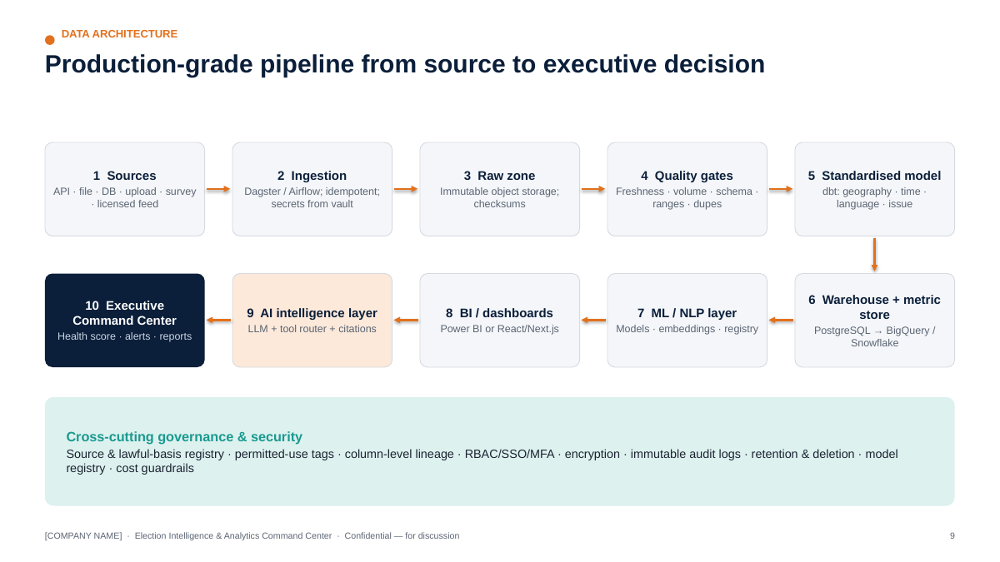

```
 SOURCES            Public/official · Campaign-owned · Survey · Digital platforms · Media (licensed) · Field · Call-centre
   │
 ACCESS MODES       API connector (verified) · file drop · DB replication · validated upload · survey export · licensed feed
   │
 INGESTION          Orchestrated jobs (Dagster/Airflow) · idempotent loads · schema contracts · secrets from vault
   │
 RAW ZONE           Object storage, immutable, partitioned by source/date, checksum + ingestion metadata
   │
 DATA-QUALITY       Tests: freshness · volume · schema · nulls · ranges · duplicates · integrity → quarantine on fail
   │
 STANDARDISED MODEL dbt models: staging → conformed dimensions (geography, time, language, issue, channel) → facts
   │
 WAREHOUSE          PostgreSQL (POC / single AC) → BigQuery or Snowflake (multi-AC / state) · metric store
   │
 ML / NLP LAYER     Batch & streaming inference · model registry · feature tables · embeddings (pgvector / FAISS)
   │
 BI / DASHBOARD     Power BI (fast rollout) or React/Next.js (bespoke Command Center) · Streamlit for POC prototypes
   │
 AI INTELLIGENCE    LLM + tool router (metrics API, SQL templates, search, vector retrieval) · guardrails · citation builder
   │
 EXECUTIVE COMMAND CENTER   Health score · 14 modules · alerts · reports · AI Analyst · compliance tower
```

## 11.2 Technology choices — and why each exists

We deliberately avoid "every tool". Each component earns its place:

| Layer | Recommended | Why it exists | When to choose alternatives |
|---|---|---|---|
| Language | **Python + SQL** | Python for ingestion, statistics, ML/NLP; SQL for transformation and analytics — the common language of analysts and engineers | — |
| Operational DB + POC warehouse | **PostgreSQL** (managed, Indian region) | Reliable, cheap, strong SQL, row-level security, **pgvector** for embeddings — one engine for POC | Move analytics to BigQuery/Snowflake when data > ~1 TB or > 50 concurrent analysts |
| Scale warehouse | **BigQuery** (GCP) *or* **Snowflake** | Serverless scale, separation of storage/compute, strong governance | Choose per the Agency's cloud preference and existing contracts |
| Cloud | **AWS / Azure / GCP** — Indian regions | Data residency, managed security services | Follow client preference; avoid multi-cloud in POC |
| Orchestration | **Dagster** (asset-centric, built-in lineage) *or* **Airflow** (widely known) | Scheduling, retries, dependencies, observability | Airflow if the client's team already runs it |
| Transformation | **dbt** | Versioned SQL models, tests, documentation, lineage | — |
| Data quality | dbt tests + Great Expectations-style checks | Automated quality gates | — |
| Statistics | **Pandas, NumPy, SciPy, Statsmodels** | Weighting, CIs, significance tests, time-series | — |
| ML | **scikit-learn**, gradient boosting (LightGBM/**XGBoost** where it beats simpler models) | Tabular models with explainability | PyTorch only where deep models are justified |
| NLP | **Transformers**, multilingual encoders (e.g., MuRIL, IndicBERT, XLM-R-class), **IndicTrans2** for translation | Indian-language coverage incl. Hinglish/romanised text | Commercial APIs where accuracy is proven on our gold sets and data terms allow |
| Embeddings / retrieval | **SentenceTransformers** (multilingual models) + **pgvector** (POC) / **FAISS** (large, in-memory) | Semantic search, clustering, duplicates, RAG | Managed vector DB only at very large scale |
| API | **FastAPI** | Typed, fast, OpenAPI docs, easy auth integration | — |
| BI | **Power BI** (Agency-friendly, RLS, mobile) *or* **React/Next.js** | Leadership dashboards | React for a bespoke, branded Command Center; Power BI for speed |
| Prototype UI | **Streamlit** | 1–2 day iterations during POC | Not for production leadership use |
| LLM | Enterprise LLM endpoint with no-training-on-data terms and Indian/approved region where available | AI Analyst & summarisation | Self-hosted open model where data terms require |
| Observability | Cloud monitoring + OpenTelemetry; pipeline dashboards | Know when data or models break | — |
| Secrets | Cloud KMS + secrets manager / Vault | No credentials in code | — |

## 11.3 Metric store (semantic layer) — *added capability*

Every KPI (e.g., `engagement_rate`, `answer_rate`, `activity_completion_rate`) is defined **once** — formula, grain, filters, owner, version — and consumed identically by dashboards, reports and the AI Analyst. This single addition removes the most common source of leadership distrust: "why does your number differ from theirs?"

# 12. Conceptual Data Model

**Design rule:** the model stores **aggregate or appropriately authorised operational records**. There is **no table of individuals' political beliefs, preferences or vote intentions**. Survey microdata is anonymous/pseudonymised, holds coarse demographic bins only, and is used for weighted aggregate estimates.

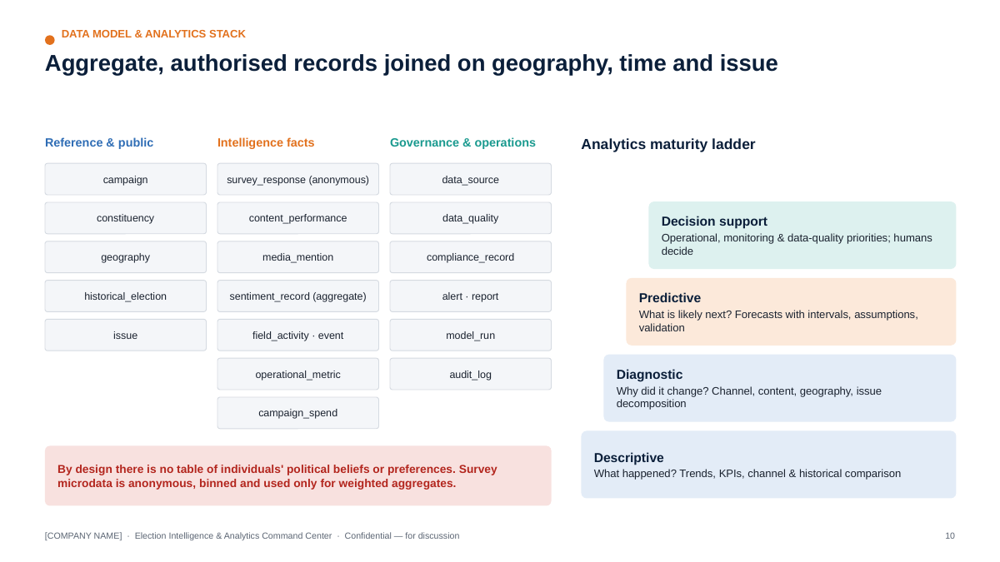

```
 campaign ─┬─< constituency >── geography (state/district/AC/block/zone; official codes)
           │        └─< historical_election (year, turnout, electors, party vote share — public)
           ├─< data_source >──< data_quality (test, status, score, run_at)
           ├─< survey >──< survey_question
           │        └──< survey_response (anonymous, weight, bins, QC flags) ──> issue
           ├─< digital_channel >──< content >──< content_performance (daily) 
           │                          └──< compliance_record (approval, MCMC ref, AI label, audit)
           ├─< campaign_spend (channel, category, amount, certification ref)
           ├─< media_mention (outlet type, language, topic, tone) ──> issue
           ├─< sentiment_record (aggregated social: date × platform × topic × language × zone*) ──> issue
           ├─< field_activity (zone, type, planned, completed, attendance est.) ──> event
           ├─< operational_metric (call-centre & ops aggregates)
           ├─< alert (rule, severity, status, owner, ack/closure)
           ├─< report (type, period, version, approver, distribution)
           └─< model_run (model, version, data window, metrics, approval)
   * zone only where public location metadata exists and is permitted
```

| Entity | Grain | Key fields | Sensitivity |
|---|---|---|---|
| campaign | One per engagement | name, phase, dates | Low |
| constituency | AC/PC | official code, name, state, reserved category (public) | Public |
| geography | Admin unit | code, parent, level, geometry ref, boundary source/version | Public |
| historical_election | AC × election | electors, votes polled, turnout %, party vote share (public) | Public |
| survey | Wave | design, mode, fieldwork dates, vendor, target n, weighting scheme | Internal |
| survey_question | Question | wording (all languages), scale, version | Internal |
| survey_response | Anonymous respondent × wave | age band, gender, area type, zone, answers, weight, QC flags, consent flag | Confidential (pseudonymised) |
| digital_channel | Account/page/channel | platform, owner, authorised token ref | Internal |
| content | Creative/post | format, theme, language, length, publish time, AI flag | Internal |
| content_performance | Content × day | impressions, reach, engagement, views, watch time, clicks, spend | Internal |
| media_mention | Article/segment | outlet, type, language, topic, tone, reach tier, URL, licence ref | Internal |
| issue | Taxonomy node | name, parent, keywords/examples, languages | Internal |
| sentiment_record | Date × platform × topic × language (× zone) | counts by label, mean score, coverage | Internal (aggregate) |
| field_activity | Activity | zone, type, planned/completed, attendance estimate, report timeliness | Internal |
| event | Event | type, zone/site, date, estimated attendance | Internal |
| operational_metric | Metric × day × unit | call volume, answer rate, FCR, backlog | Internal |
| campaign_spend | Line item | channel, vendor, category, amount, certification ref | Confidential |
| compliance_record | Content × control | approval, certification, AI label, takedown, audit | Confidential |
| data_source | Source | registry fields (§9) | Internal |
| data_quality | Test run | test, status, rows affected, score | Internal |
| alert | Alert | rule, severity, entity, status, owner, timestamps | Internal |
| report | Report | type, period, version, approver | Internal |
| model_run | Run | model, version, window, metrics, approval | Internal |

A conceptual DDL is provided in `poc/schema.sql`.

# 13. Analytics Layer & Intelligence Modules

## 13.1 Analytics catalogue

| Level | Question | Examples | Methods | Output guardrail |
|---|---|---|---|---|
| **Descriptive** | What happened? | Daily/weekly/monthly trends; KPI summaries; channel performance; historical comparison vs previous elections (turnout, electors) | Aggregations, rolling baselines, indexed comparisons | Show "data as of", source, quality |
| **Diagnostic** | Why did a KPI change? Which factor/content/channel/geography changed? | Engagement down 18% W/W → driven by X platform, static images, 2 themes; completion drop concentrated in Hill Block | Contribution/variance decomposition, drill-down, mix-vs-rate analysis, change-point detection | Label as "contributing factors", not causes, unless tested |
| **Predictive** (where statistically justified) | What is likely next? | Issue-volume and media-volume forecasts; digital performance forecasts; turnout-*trend* estimates at AC level from historical/public data; campaign operations forecasts (completion, backlog) | Time-series models, regression, gradient boosting | Every forecast shows interval, assumptions, training window, validation metric, limitations; **never certainty; never individual-level** |
| **Decision support** | What should we look at / prioritise operationally? | Operational priorities (zones behind plan), data-quality priorities, monitoring priorities (rising issues), resource-measurement insights, content-performance learnings, recommended analytical follow-ups | Rules + ranking + analyst judgement | **No individualised persuasion instructions**; recommendations are operational/analytical, owned by humans |

## 13.2 Social Listening module

**Pipeline:** Social Listening → NLP → Topic → Sentiment → Trend → Alert.

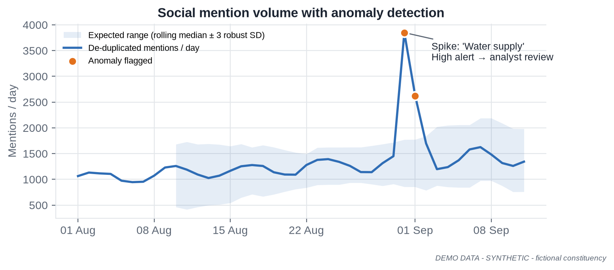

| Dashboard component | Definition | Warning shown |
|---|---|---|
| Mention volume | De-duplicated public mentions matching the campaign's tracked keywords/entities | Coverage index; platform mix |
| Sentiment | Distribution of positive/neutral/negative with model confidence; net sentiment with bootstrap CI | "Public social data only — not representative of the electorate" |
| Topic trends | Share of mentions by issue taxonomy over time | Classifier accuracy per language |
| Issue velocity | Growth rate of an issue vs its 7-day baseline (z-score / robust MAD) | Minimum-volume threshold |
| Engagement | Interactions on public posts in scope | Platform-reported; not comparable across platforms without indexing |
| Content performance | Top public posts by engagement (aggregate) | No profiling of individual posters |
| Creator/media amplification | Accounts/outlets driving *reach* on a topic — public figures, media houses, verified organisations | **Aggregated by account type**; no private individuals profiled |
| Platform comparison | Volume/sentiment split by platform | Access differs per platform |
| Geographic aggregation | Zone/district only where public location metadata exists and use is permitted | Typically < 20% of posts carry usable location — shown explicitly |
| Time-series movement | Hourly/daily lines with anomaly bands | — |
| Emerging-issue detection | New clusters of semantically similar posts growing faster than baseline | Human analyst validates before escalation |

**Coverage & Representativeness Index (added capability)** — each tile shows: platforms covered, % of posts with language confidence ≥ threshold, % geo-attributable, estimated duplicate share, and a standard caveat. In the DEMO data: 18.1% geo-attributable, 7.0% near-duplicates removed.

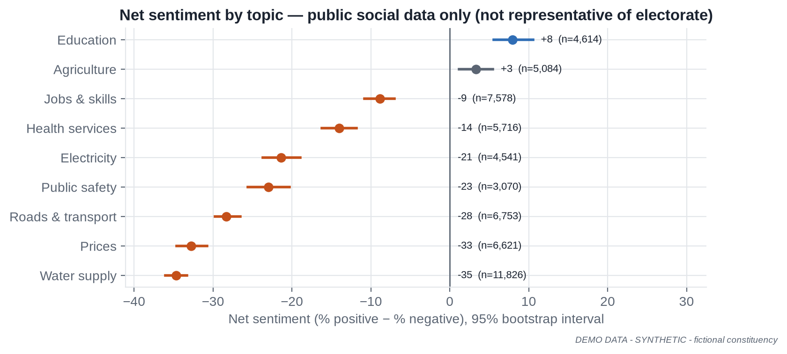

## 13.3 Media Intelligence module

| Component | Description |
|---|---|
| Media monitoring | Ingest licensed/public news feeds, regional outlets, broadcast transcripts (licensed) |
| Article classification | Issue taxonomy; article type (news, opinion, interview, explainer) |
| Topic extraction | Keyphrases, clusters, story threads across outlets |
| Sentiment / tone | Tone towards tracked entities/issues, with confidence |
| Candidate/organisation mention | NER + entity linking to a curated list of public figures and organisations |
| Issue tracking | Share of voice by issue, outlet type, language, region |
| Media-volume trend | Daily/weekly volume with anomaly detection |
| Regional media monitoring | Indian-language outlets prioritised; translation for leadership summaries |
| Broadcast transcript analysis | **Only where licensed**; transcript segments classified like articles |
| Alerting | Spike in volume/negative tone for an issue; high-reach outlet coverage |

**Media Intelligence Dashboard** layout: KPI strip (articles 24h / 7d, % negative, share of regional coverage, top issue) → weekly volume by outlet type → issue × tone matrix → story-thread list with outlet count and first-seen time → "coverage map" by district (where outlet geography is known) → daily AI summary with citations.

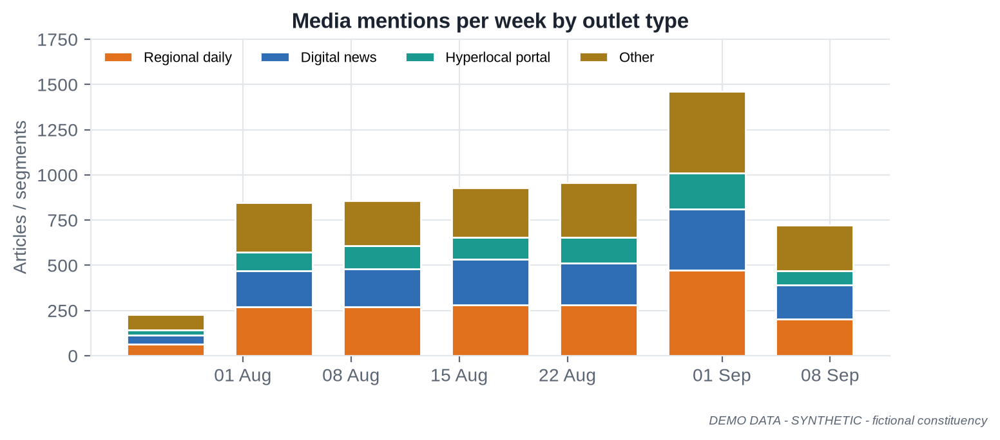

## 13.4 Survey Intelligence module

| Capability | Specification |
|---|---|
| Questionnaire design support | Neutral-wording checklist, scale balance, order rotation, translation/back-translation, cognitive pre-test log, sensitive-question review (no vote-intention questions unless the Campaign's research lead and legal approve and outputs remain aggregate and internal) |
| Sampling | Design registry (stratified/cluster/quota), sampling frame description, allocation by stratum |
| Sample-size calculation | n = z²·p(1−p)/e² × deff, with finite-population correction where relevant; calculator in the UI |
| Weighting | Post-stratification / raking to Census/official margins; trimming (e.g., 0.3–3.0); weight diagnostics |
| Confidence intervals & MoE | Using effective sample size; shown by default |
| Cross-tabulation | Weighted cross-tabs with column %, n and MoE; suppression of cells with n < 50 |
| Statistical significance | Two-proportion z-tests with design effect; wave-over-wave change flags; multiple-comparison control (Benjamini–Hochberg) for large cross-tab batteries |
| Response quality | Speeders, straight-liners, duplicates, interviewer effects, GPS/time anomalies (tablet F2F), back-check results |
| Missing data | Item non-response rates; explicit "Don't know/Refused"; imputation only when documented |
| Bias checks | Sample vs population profile; mode effects; non-response analysis |
| Trend comparison | Same-question, same-population comparisons only; methodology changes flagged |

**DEMO example:** Wave 3 (n = 3,851; effective n = 3,704 after weighting) shows 21.0% ± 1.3 naming *water supply* as the top local issue vs 13.0% in Wave 1 — a change of +8.0 points, statistically significant (z ≈ 9). Awareness of the campaign's public programme rose from 30.2% to 44.1%. **Surveys describe the sampled population at fieldwork time; they do not guarantee or predict election results.**

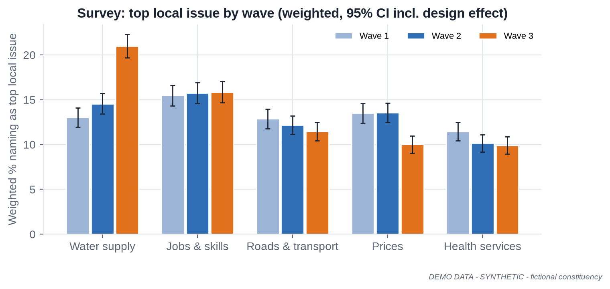

## 13.5 Field Operations Analytics module

| KPI | Definition |
|---|---|
| Activity completion rate | Completed / planned activities |
| Event count | Events held by type |
| Attendance (where lawfully recorded) | Headcount *estimates* per event; no identity capture |
| Geographic coverage | % of zones with ≥ 1 completed activity in last 7 days |
| Issue-report volume | Local issue reports logged by category |
| Volunteer activity | Active volunteers, tasks per volunteer (aggregate) |
| Task completion | On-time task completion % |
| Response time | Time from issue report to acknowledgement |
| Data submission quality | Timeliness + completeness + validation pass rate |
| Operational bottlenecks | Zones/blocks with persistent under-completion or late reports |

**Field Operations Dashboard:** completion by zone (map), completion trend, on-time reporting by block, bottleneck list with owner, issue-report categories.

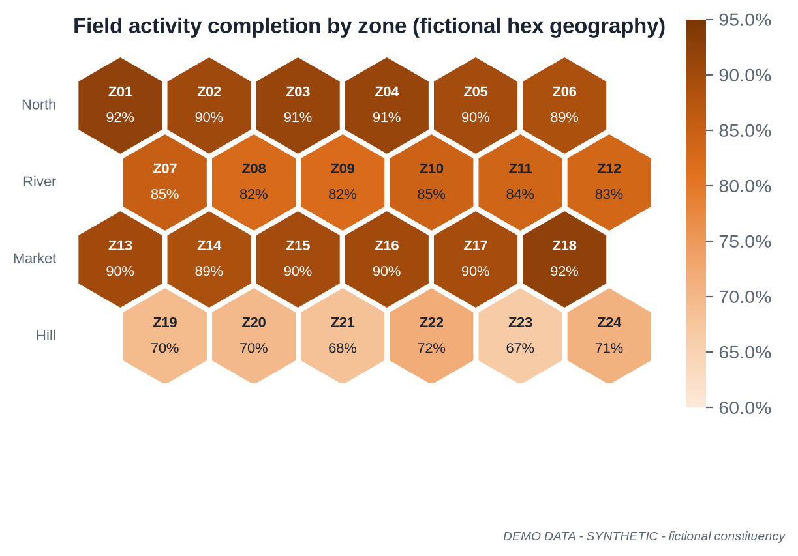

## 13.6 Call-centre Analytics module (if authorised data is available)

Metrics: call volume, answer rate, response/wait time, issue categories, resolution rate (first-contact and overall), follow-up status, language mix, geographic aggregation (zone/district), agent performance (operational metrics for the helpline's own management, not surveillance beyond lawful workplace norms), quality-monitoring scores. **Not used:** private communications, unauthorised personal data, or any inference about callers' political views. Recordings/transcripts only where callers are informed and the Campaign's legal team has approved.

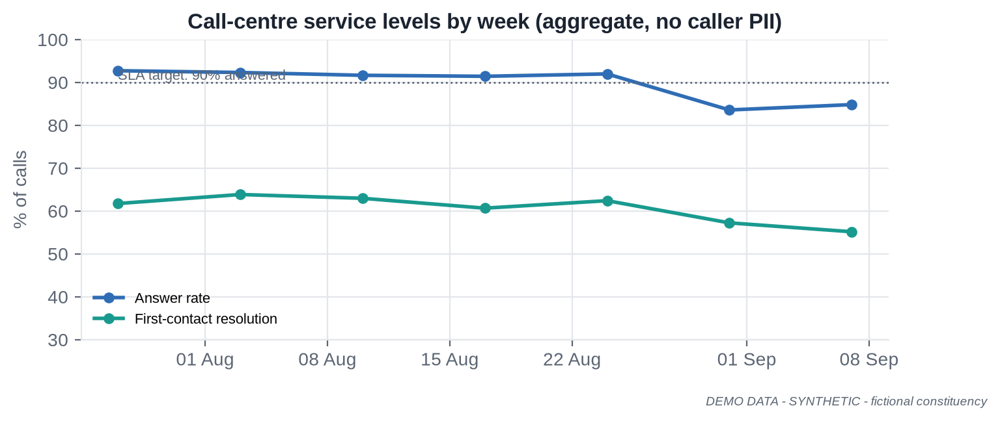


# 14. Machine Learning & Multilingual NLP

## 14.1 Model catalogue

**Hard rule:** no model infers an individual's political ideology, preference or likely vote. Models operate on aggregates, content, text of public/licensed items, or operational records.

**(a) Purpose, inputs, outputs and method**

| # | Model | Purpose | Input | Output | Method |
|---|---|---|---|---|---|
| M1 | KPI driver regression | Explain which factors are associated with engagement changes | Content features (format, theme, length, language, hour, platform, boost) | Coefficients / partial effects with CIs | OLS / regularised regression on log engagement |
| M2 | Content "high-performer" classifier | Flag content likely to exceed median ER *for format planning* | Content metadata (no audience attributes) | Probability + drivers | Logistic regression → gradient boosting if lift justified |
| M3 | Issue/topic classifier | Map text to the campaign issue taxonomy | Public/licensed text, survey open-ends, field issue notes | Issue label(s) + confidence | Fine-tuned multilingual encoder; zero-shot fallback |
| M4 | Sentiment/tone classifier | Aggregate sentiment/tone by topic | Public/licensed text | Pos/neu/neg + confidence | Fine-tuned multilingual encoder |
| M5 | Clustering / emerging-topic detection | Find new story clusters | Text embeddings | Clusters, keyphrases, growth | Embeddings + HDBSCAN/BERTopic-style topic modelling |
| M6 | Near-duplicate detector | De-duplicate; spot copy-paste amplification | Text, embeddings, MinHash | Duplicate groups | MinHash/LSH + cosine similarity |
| M7 | Time-series forecaster | Issue-volume, media-volume, digital KPI, ops forecasts | Daily series + calendar features | Point forecast + 80/95% intervals | Seasonal regression / ETS / Prophet-class; gradient boosting for multi-series |
| M8 | Anomaly detector | Spikes/drops in any KPI | Time series | Anomaly score, severity | Robust rolling median ± k·MAD; STL residuals; isolation forest for multivariate |
| M9 | Turnout-trend model (aggregate) | Contextualise AC-level turnout trends for **operational planning** | Public historical turnout, electors, polling stations, public development indicators | Expected turnout range per AC (not per person) | Hierarchical/regularised regression; Random Forest benchmark |
| M10 | Survey weighting & small-area estimates | Robust aggregate estimates | Survey microdata + population margins | Weighted estimates, MoE | Raking; MRP only with strong justification |
| M11 | PCA / factor analysis | Reduce many indicators to interpretable dimensions (e.g., development index) | Public indicators at AC/district | Components, loadings | PCA |
| M12 | NER & entity linking | Identify public figures, organisations, places, schemes | Public/licensed text | Entities + IDs | Multilingual NER + curated gazetteer |
| M13 | Toxicity / safety classifier | Protect analysts; flag abusive content in monitored spaces | Public text | Toxicity score | Multilingual classifier |
| M14 | Misinformation-risk flagger | Prioritise items for human fact-checking | Public text + propagation features | Risk score + reasons | Claim-matching against verified fact-check library + heuristics |

**(b) Evaluation, risks, limitations and human review**

| # | Model | Evaluation metric | Key risk | Limitations | Human review |
|---|---|---|---|---|---|
| M1 | KPI driver regression | Adj. R², out-of-sample RMSE, coefficient stability | Confounding read as causation | Associational, not causal | Analyst signs off interpretation |
| M2 | Content "high-performer" classifier | ROC-AUC, calibration (Brier), precision@k | Self-fulfilling feedback | Platform algorithm changes shift behaviour | Digital lead reviews |
| M3 | Issue/topic classifier | Macro-F1 per language on gold set | Taxonomy drift, code-mixing errors | Weak on rare dialects | Low-confidence items to analyst queue |
| M4 | Sentiment/tone classifier | Macro-F1, per-class recall, per-language F1 | Sarcasm, political idiom, bias across languages | Social ≠ population | Monthly re-validation |
| M5 | Clustering / emerging-topic detection | Topic coherence, analyst usefulness rating | Spurious clusters | Needs minimum volume | Analyst validates new topic before alert ≥ High |
| M6 | Near-duplicate detector | Precision/recall on labelled pairs | Over-merging similar genuine posts | Paraphrase-heavy campaigns | Coordinated-copy flags reviewed by analyst |
| M7 | Time-series forecaster | MAPE/sMAPE, interval coverage on hold-out | Event shocks | Short histories | Forecast note signed by DS |
| M8 | Anomaly detector | Precision/recall on labelled incidents; alert fatigue rate | False positives | Low-volume series noisy | Triage by war-room analyst |
| M9 | Turnout-trend model (aggregate) | MAE on held-out past elections, interval coverage | Over-interpretation | Structural breaks (delimitation, roll revisions) | Published only internally with caveats |
| M10 | Survey weighting & small-area estimates | Benchmark comparison, design effect | Model-driven small-area noise | Needs adequate sample per cell | Research lead approves |
| M11 | PCA / factor analysis | Variance explained, loading stability | Misleading labels | Linear | Analyst names components |
| M12 | NER & entity linking | F1 on gold set | Ambiguous names | Transliteration variants | Gazetteer curated by analysts |
| M13 | Toxicity / safety classifier | Precision/recall on gold set | Dialect bias | Context-dependence | Human decision on any action |
| M14 | Misinformation-risk flagger | Precision@k of analyst-confirmed items | Labelling legitimate speech as "fake" | Cannot determine truth | **Always human-verified**; never auto-labelled |

## 14.2 Multilingual NLP layer

| Capability | Approach | Notes |
|---|---|---|
| Language detection | fastText-class LID + script detection + Hinglish/romanised heuristics | Code-mixed text is the norm, not the exception |
| Hindi, English, Hinglish | Multilingual encoders (MuRIL, IndicBERT, XLM-R-class) fine-tuned on campaign gold sets | Separate metrics for each |
| Regional languages | Per-language evaluation; IndicTrans2 (22 scheduled languages, MIT licence) for translation where needed | Prioritise the languages of the target geography |
| Romanised Indian languages | Transliteration normalisation (e.g., IndicXlit-class) before classification | Major error source if ignored |
| Spell correction / normalisation | Lexicon + transliteration-aware normalisation | Preserve original text for audit |
| Topic classification | M3 | — |
| Sentiment | M4 | — |
| NER | M12 | — |
| Event detection | Burst detection on entity + location + keyphrase co-occurrence | Analyst validation |
| Issue extraction | Taxonomy classification + keyphrase extraction | — |
| Trend detection | Velocity vs baseline, change-points | — |
| Duplicate detection | M6 | — |
| Toxicity/safety | M13 | — |
| Misinformation-risk | M14 | — |
| Content classification | Format/theme tagging of owned content | Feeds content matrix |

**Human-labelled gold sets (added capability).** For each priority language (incl. Hinglish and romanised forms) we build a stratified gold set (target ≥ 1,500 items per language for sentiment/topic in production; ≥ 500 in POC), double-annotated with inter-annotator agreement (Cohen's κ ≥ 0.70 target). Models are accepted only if they meet per-language thresholds (e.g., macro-F1 ≥ 0.70 for sentiment in POC; ≥ 0.75 in production) and **results are reported per language**, not just overall.

# 15. AI Campaign Analyst & RAG

## 15.1 Purpose

A secure, internal assistant that answers leadership and analyst questions **from approved, governed data only**, e.g.:

- "What changed in the last 24 hours?"
- "Which issues are trending?"
- "Show digital performance versus last week."
- "What data sources have quality issues?"
- "Summarise today's media coverage."
- "Which campaign activities had the highest measured engagement?"
- "Compare this week with the previous four weeks."

## 15.2 Architecture

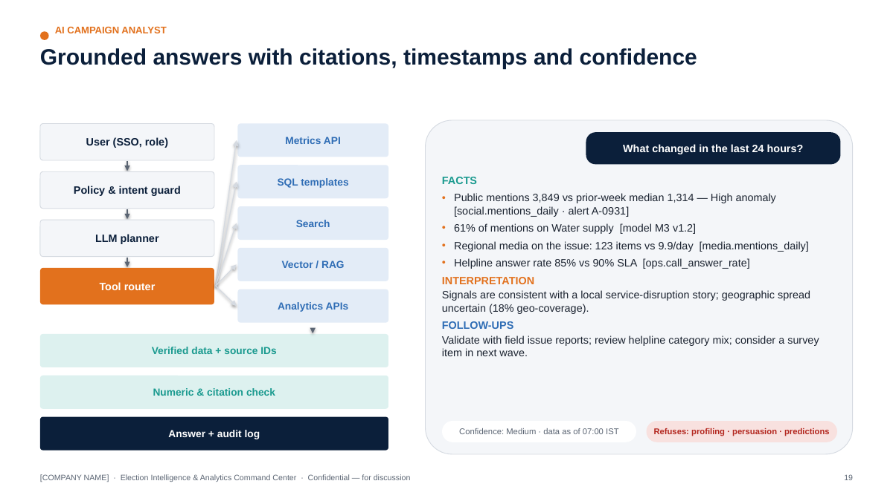

```
 User (SSO, role) ──► Policy & intent guard ──► LLM planner ──► Tool router
                                                                  │
          ┌──────────────────────┬────────────────────┬───────────┴─────────┬─────────────────────────┐
          ▼                      ▼                    ▼                     ▼                         ▼
   Metrics API (metric     Parameterised SQL     Search over         Vector retrieval (RAG)     Analytics APIs
   store, RLS-enforced)    templates (read-only)  reports/alerts      + metadata filters +        (forecast, anomaly,
                                                                      reranker                    survey engine)
          └──────────────────────┴────────────────────┴─────────────────────┴─────────────────────────┘
                                                      │  verified data + source IDs + timestamps
                                                      ▼
                          Answer composer ──► Grounding & numeric checker ──► Response with citations,
                                                                              "data as of", confidence,
                                                                              facts vs interpretation
                                                      │
                                                      ▼
                                   Audit log (prompt, tools, sources, model version, answer)
```

## 15.3 Behavioural contract

The AI Analyst **must**:

1. Retrieve source data through tools — never answer numeric questions from model memory.
2. Cite internal sources (dataset/metric ID, report ID, document + page) for every factual claim.
3. Show the data timestamp ("data as of 07:00 IST").
4. Show confidence (High/Medium/Low) based on data quality, coverage and model confidence.
5. Separate **Facts** (from data) and **Interpretation** (analyst-style reading), labelled.
6. Never fabricate numbers; the numeric checker verifies every number in the answer appears in tool outputs (or is a deterministic calculation from them).
7. Never invent sources; citations are generated from tool metadata, not by the LLM.
8. Never make unsupported political predictions (e.g., seat or vote-share predictions) and never produce individual-level profiling or persuasion scripts — it declines and explains.
9. Respect RBAC: the user sees only what their role permits; retrieval is filtered by permissions.

**Example (DEMO):**

> **Q:** What changed in the last 24 hours?
>
> **Facts** — (1) De-duplicated public mentions: 3,849 on 31 Aug vs prior 7-day median 1,314 — flagged **High** anomaly *[metric: social.mentions_daily; alert A-0931; data as of 01 Sep 07:00]*. (2) 61% of that day's mentions relate to *Water supply* *[model M3 v1.2]*. (3) Regional/hyperlocal media items on the same issue: 123 in 24h vs a prior daily average of 9.9 *[media.mentions_daily]*. (4) Helpline answer rate on 31 Aug: 85% (SLA 90%) *[ops.call_answer_rate]*.
>
> **Interpretation** — The social and media signals are consistent with a local service-disruption story. Social data covers public posts only (18% geo-attributable), so geographic spread is uncertain.
>
> **Suggested analytical follow-ups** — Validate with field issue reports from affected zones; check call-centre category mix; add a question in the next survey wave if the issue persists.
>
> *Confidence: Medium (coverage limits). Sources: 4 datasets, 1 alert.*

## 15.4 RAG knowledge base

| Collection | Contents (authorised only) | Metadata | Access |
|---|---|---|---|
| Campaign reports | Daily/weekly reports, analyses | date, type, author, approval | Role-based |
| Historical reports | Past campaign reviews | year, geography | Role-based |
| Survey methodology | Questionnaires, sampling, weighting notes | wave, vendor | Research + leadership |
| Public election documents | ECI statistical reports, handbooks, MCC compendia, press notes | issuing body, date, URL | All |
| Campaign SOPs | War-room SOPs, escalation matrix | version | All |
| Content-performance reports | Test results, learnings | period, channel | Digital + leadership |
| Media reports | Daily summaries | date | Media + leadership |
| Compliance documents | Approved policies, legal guidance received | version, approver | Compliance + leadership |

Pipeline: document intake (approval required) → parsing/OCR → chunking by structure → multilingual embeddings → vector index (pgvector/FAISS) + BM25 hybrid → **metadata filtering** (role, date, doc type) → **reranking** (cross-encoder) → **grounded generation** with quote-level citations → citation verification → answer. Every answer carries **source traceability** to document ID and page/section.

## 15.5 Hallucination protection & red-team harness (added capability)

| Control | Mechanism |
|---|---|
| Tool-first answering | Numeric intents must call a tool; no tool → "I don't have verified data for that" |
| Numeric grounding check | Regex-extract numbers from the draft; each must match tool output (tolerance for rounding) |
| Citation integrity | Citations inserted from tool metadata; LLM cannot author citation strings |
| Refusal policy | Classifier + rules for out-of-policy requests (individual profiling, persuasion scripts, outcome predictions, legal conclusions) |
| Evaluation set | 200+ questions (POC: 60) with expected sources; measured weekly: answer accuracy, citation validity, refusal correctness |
| Red-team prompts | Prompt-injection in retrieved documents, requests for PII, "predict the winner", "write a message to persuade X", jailbreaks |
| Versioning | Prompts, tools and model versions logged per answer; regression tests on change |

# 16. Security

| Control | Specification |
|---|---|
| **RBAC** | Roles mapped to SSO groups; least privilege; row-level security by geography/team; column masking for sensitive fields |
| **SSO** | SAML 2.0 / OIDC with the Agency's identity provider |
| **MFA** | Mandatory for all users; phishing-resistant (FIDO2/passkeys) for admins |
| **Encryption at rest** | AES-256 with cloud KMS; customer-managed keys in Enterprise tier |
| **Encryption in transit** | TLS 1.2+ everywhere; HSTS; mTLS for service-to-service in production |
| **Secrets management** | Cloud secrets manager/Vault; no secrets in code, notebooks or chat; automated secret scanning in CI |
| **Audit logs** | Centralised, immutable; retention per §9; alerts on anomalous access (bulk export, off-hours admin) |
| **API key rotation** | ≤ 90 days; immediate on staff exit or suspected exposure |
| **Environment separation** | Separate dev/test/prod accounts/projects; prod data never in dev; synthetic data for testing |
| **Backup** | Daily snapshots + PITR; encrypted; cross-zone in-region |
| **Disaster recovery** | Documented DR plan; RPO/RTO per §7; semi-annual DR test; poll-week warm standby (Enterprise) |
| **Incident response** | 24×7 on-call in high-intensity phase; CERT-In 6-hour reporting path; DPDP breach workflow; comms templates |
| **Data retention** | Per Source Registry; automated purges |
| **Least privilege** | Just-in-time elevation; quarterly access reviews; separate break-glass accounts |
| **Endpoint & people** | Managed devices for analysts; DLP on exports; security training; background checks for privileged roles |
| **Application security** | OWASP ASVS L2 target; dependency scanning; annual third-party penetration test (pre-high-intensity phase) |
| **LLM security** | Prompt-injection defences; output filtering; no training on client data (contractual); data-region controls |

# 17. Responsible AI & Model Governance

## 17.1 Responsible AI principles

| Principle | What it means in this platform |
|---|---|
| Human oversight | Humans decide; AI drafts, flags and explains. Critical alerts and all external-facing outputs require human sign-off |
| No fabricated information | Tool-grounded answers; numeric and citation checks |
| No unsupported prediction | Forecasts only where validated; intervals and limitations always shown; no seat/vote predictions from social data |
| Explainability | Driver analysis, feature importance, model cards; plain-language explanations for leadership |
| Source traceability | Every number → metric → dataset → source |
| Data minimisation | Aggregate early; drop unnecessary identifiers |
| Privacy | DPDP-aligned; pseudonymisation; purpose limitation |
| Security | §16 |
| Bias monitoring | Per-language, per-region performance tracking of NLP models; survey representativeness checks |
| Model monitoring | Drift, performance decay, alert precision |
| Synthetic-content safeguards | Platform does not generate campaign creative; tracks AI provenance and labels; supports 3-hour takedown workflows |
| Compliance review | Legal/compliance review of policies, prompts that touch compliance, and any new data purpose |

Alignment references: MeitY **India AI Governance Guidelines** (5 Nov 2025; seven guiding principles), **NIST AI RMF 1.0**, **ISO/IEC 42001:2023** (AI management systems).

## 17.2 Three kinds of "AI" — kept strictly separate

| Category | Definition | Examples | Governing controls |
|---|---|---|---|
| **AI-assisted analytics** | AI used internally to analyse data and draft internal insights | Topic classification, forecasts, AI Analyst answers | Model governance, human review, citations. Internal outputs are not campaign content |
| **AI-generated content** (general) | Any text/image/audio/video produced or materially altered by AI | Draft summaries, translated reports | Internal-use labelling; human review before any external use |
| **AI-generated campaign creative** | Synthetic or AI-altered media published for campaigning | AI-generated video/image/audio ads or posts | **ECI advisory (24 Oct 2025)**: visible label (≥10% area; audio first 10%), responsible-entity disclosure, no deceptive likeness without consent, record-keeping, 3-hour takedown; IT Rules 2026 SGI labelling. **Out of the platform's generation scope** — the Control Tower only tracks provenance, labels and approvals |

## 17.3 Model governance — model card template (required for every model)

| Field | Example (M7 — issue-volume forecaster, DEMO) |
|---|---|
| Model name | `issue_volume_forecaster` |
| Purpose | 14-day forecast of daily de-duplicated mention volume for monitoring-capacity planning |
| Dataset | `social.mentions_daily` (DEMO), anomalies excluded from fit |
| Training period | 01–24 Aug 2026 (validation 25–30 Aug) |
| Features | Linear trend, weekly Fourier terms |
| Target | log(daily mentions) |
| Algorithm | OLS seasonal regression (benchmark: ETS) |
| Metrics | Validation MAPE 2.2% (synthetic data — real-world error will be higher); 80/95% interval coverage tracked |
| Validation | Rolling-origin back-test; residual diagnostics |
| Bias checks | N/A for aggregate volume; platform-mix drift monitored |
| Limitations | Cannot anticipate event shocks; platform access changes break continuity |
| Owner | Lead Data Scientist |
| Version | 0.3.0 |
| Last updated | 2026-09-12 |
| Approval status | Approved for internal planning use (POC) |

Models move through **Draft → Validated → Approved → Monitored → Retired**, with approvals recorded in the model registry and every `model_run` logged.

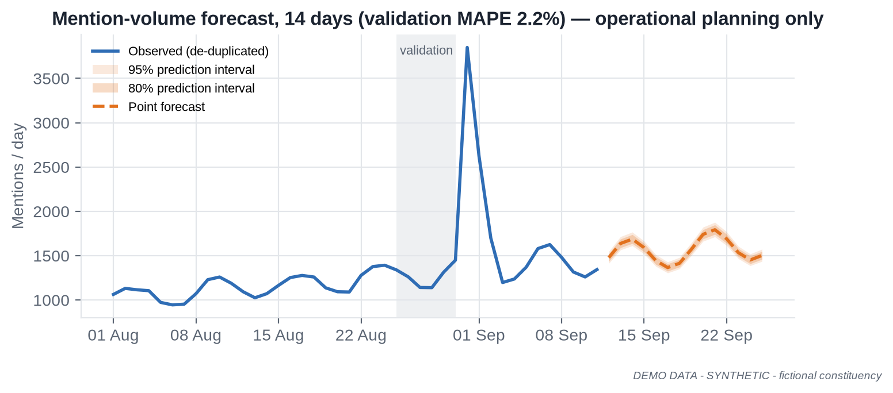


# 18. Command Center UI

## 18.1 Design principles

- **Answer first, detail on demand.** Every screen opens with 3–5 KPI cards and a one-line "what changed" statement, then charts, then tables.
- **Trust signals on every tile:** source, "data as of", data-quality badge (green/amber/red), and coverage note where relevant.
- **Uncertainty is visible:** intervals on estimates; significance markers on changes; forecasts shaded.
- **Consistent grammar:** same period selector, geography filter and language filter across modules, in one row above the charts.
- **Accessible:** WCAG 2.1 AA, colour-blind-safe validated palette, status never shown by colour alone.

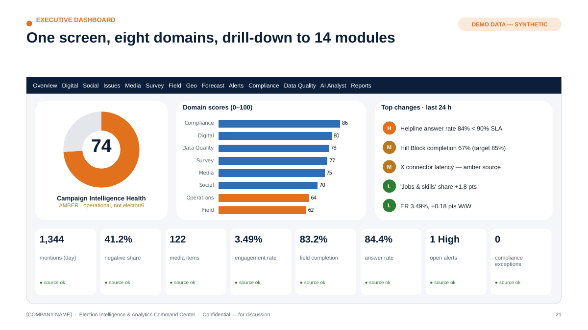

## 18.2 Home — Campaign Intelligence Health Score

A composite 0–100 index summarising eight Level-2 domains (Digital, Social, Media, Survey, Field, Operations, Data Quality, Compliance). It is an **operational health indicator**, not an electoral prediction.

- Each domain score = weighted average of normalised KPIs vs target/baseline (weights agreed with leadership in Week 1, versioned).
- The Health Score is displayed with its domain breakdown; a red domain cannot be hidden by green ones (any domain < 50 caps the headline at "Amber").
- Data Quality and Compliance scores gate trust: if Data Quality is red, the score is shown with a "low-confidence" banner.

## 18.3 Screen-by-screen wireframe descriptions

| # | Screen | Layout (top → bottom) | Primary users |
|---|---|---|---|
| 1 | **Executive Overview** | Header: Health Score dial + 8 domain chips · "Top 5 changes in last 24h" list with severity icons · KPI strip (mentions, net sentiment, media volume, digital ER, field completion, answer rate, open alerts, compliance exceptions) · 14-day trend small multiples · AI daily brief with citations | Leadership |
| 2 | **Digital Intelligence** | KPI strip (reach, impressions, ER, video views, avg watch %, CTR, CPC, CPM, spend) · platform comparison bars · Digital Performance Scorecard table vs targets · spend pacing vs plan · top/bottom content | Head of Digital |
| 3 | **Social Listening** | Coverage index banner · mention volume with anomaly band · sentiment distribution with CIs · topic share stream · platform split · emerging-cluster cards (keyphrases, growth, sample public posts) | Social analyst |
| 4 | **Issue Intelligence** | Issue taxonomy tree · cross-source issue matrix (social share, media share, survey salience, field reports, call-centre categories) · issue velocity leaderboard · issue detail drawer with timeline across sources | Research, leadership |
| 5 | **Media Intelligence** | KPI strip · weekly volume by outlet type · issue × tone heatmap · story threads with first-seen time and outlet count · regional coverage by district · licensed broadcast segments | Media cell |
| 6 | **Survey Intelligence** | Wave selector · topline with MoE · wave-over-wave change with significance markers · weighted cross-tabs (with suppression) · sample health (n, n_eff, deff, QC exclusions, profile vs population) · methodology panel | Research lead |
| 7 | **Field Operations** | KPI strip (planned, completed %, on-time %, attendance est., issue reports) · zone map · completion trend by block · bottleneck table with owners · data-submission quality | Field head |
| 8 | **Geographic Intelligence** | Layer switcher (historical results, turnout trend, survey coverage, activity coverage, events, issue distribution, media distribution, operational coverage) · AC/block/zone choropleth · side panel with selected-area profile (public + operational aggregates) | Leadership, field |
| 9 | **Forecasting** | Model selector · forecast chart with 80/95% intervals · model card summary (training window, validation metric, assumptions, limitations) · back-test accuracy history | Analysts |
| 10 | **Alerts** | Severity-sorted queue · alert detail (rule, evidence chart, affected entity, owner, SLA timer) · acknowledge / escalate / close with note · alert precision stats | War-room |
| 11 | **Compliance** | Exceptions banner · content pipeline Kanban (Draft → Review → Certified → Scheduled → Live) · certification status table · AI-label/provenance ledger · spend vs configured limits · silence-period calendar · audit trail search | Compliance officer |
| 12 | **Data Quality** | Source registry health grid (freshness, volume, tests passed) · failing tests · lineage explorer · quality score trend | Data team |
| 13 | **AI Analyst** | Chat with suggested questions · answers with Facts / Interpretation / Follow-ups, citations and "data as of" · "show the data" expanders · feedback buttons | All (role-scoped) |
| 14 | **Reports** | Daily/weekly report library · draft → review → approve workflow · export (PDF/PPTX) · distribution log | Leadership, account lead |

# 19. Real-Time Alert Engine

## 19.1 Severity levels

| Level | Definition | Response target | Channel |
|---|---|---|---|
| **Critical** | Compliance breach risk, pipeline outage on priority source, security incident, or extreme anomaly on a leadership KPI | Acknowledge ≤ 15 min; action ≤ 1 h (compliance takedown clock: < 3 h) | Phone/SMS + app + war-room screen |
| **High** | Significant anomaly (e.g., > 4 robust SD) on priority metrics; fast-growing issue; high-reach media story | Acknowledge ≤ 1 h | App + messaging integration |
| **Medium** | Notable movement (3–4 robust SD) or sustained trend change; data-quality degradation | Same day | App + daily report |
| **Low** | Informational; minor deviations; stale approvals | Weekly review | Digest |

## 19.2 Alert catalogue

| Alert | Rule (default; tunable) | Default level |
|---|---|---|
| Sudden social-volume spike | Daily/hourly mentions > rolling median + 3·(1.4826·MAD) and volume > minimum | High (Critical if > 6 SD and top-3 issue) |
| Abnormal sentiment movement | Net sentiment change beyond 99% bootstrap interval of 14-day baseline, n ≥ 300 | Medium/High |
| Viral content | Public item in scope with engagement velocity in top 0.1% of 30-day distribution | High |
| Unusual digital-performance movement | ER/CTR/CPM outside forecast 95% interval for 2 consecutive periods | Medium |
| Media spike | Media items on an issue > baseline + 3 SD or ≥ 2 high-reach outlets within 6 h | High |
| Data pipeline failure | Job failed / freshness SLA missed for priority source | Critical (priority) / Medium (other) |
| Survey anomaly | Interviewer/area outliers; QC exclusion rate > 10%; profile deviation > 5 pts | Medium |
| Data-quality deterioration | Source quality score drops > 10 pts or below 70 | Medium/High |
| Compliance deadline | Expenditure filing, certification expiry, silence-period start in < 24 h | High/Critical |
| Abnormal spend | Daily spend > 150% of pacing plan, or cumulative > 80%/95% of configured limit | High/Critical |
| Unexpected KPI movement | Any metric-store KPI outside its forecast interval | Low/Medium |
| AI label missing | AI-flagged content without label record | Critical |

**Alert hygiene:** de-duplication and grouping (one incident, many signals), suppression windows, owner assignment, closure notes, weekly precision review (target ≥ 60% of High/Critical alerts rated "useful" by the war-room).

# 20. KPI Framework

## 20.1 KPI tree

```
LEVEL 1  Campaign Intelligence Health (0–100, operational)
   │
LEVEL 2  Digital · Social · Media · Survey · Field · Operations · Data Quality · Compliance
   │
LEVEL 3  (detailed, measurable KPIs below)
```

| Level 2 | Level 3 KPIs | Type |
|---|---|---|
| **Digital** | Reach; impressions; engagement rate; video views; avg watch %; CTR; CPC; CPM; landing-page conversion (sign-ups/volunteer forms — lawful, consented); spend vs pacing | Leading (ER, CTR) / Lagging (reach totals) |
| **Social** | De-duplicated mention volume; net sentiment (with CI); issue share; issue velocity; share of voice among tracked entities; emerging-cluster count | Leading / Diagnostic |
| **Media** | Media volume; tone distribution; issue share; regional share; high-reach outlet coverage; story-thread count | Leading / Diagnostic |
| **Survey** | Issue salience (weighted, MoE); programme awareness; service satisfaction; wave-over-wave significant changes; sample health (n_eff, deff) | Lagging (periodic) / Data-quality |
| **Field** | Activity completion %; zone coverage %; on-time reporting %; issue reports logged; response time | Leading (operational) |
| **Operations** | Call answer rate; FCR; median wait; backlog; alert acknowledgement time; report on-time delivery | Leading (operational) |
| **Data Quality** | Sources green %; freshness SLA %; test pass rate; duplicate rate; coverage index; lineage completeness | Data-quality |
| **Compliance** | Paid items with certification ref %; AI items labelled %; approvals within SLA %; silence-period violations (target 0); takedown within 3 h %; spend within configured limits | Leading (risk) |

## 20.2 Indicator types

| Type | Purpose | Examples |
|---|---|---|
| Leading | Move before outcomes; used for early action | Issue velocity, ER, field completion, alert acknowledgement |
| Lagging | Confirm outcomes over time | Survey awareness, cumulative reach, weekly satisfaction |
| Diagnostic | Explain movement | Platform/format/theme mix, zone breakdown |
| Data-quality | Tell you whether to trust the rest | Freshness, coverage, test pass rate, n_eff |

# 21. Digital Campaign & Content Intelligence

## 21.1 Digital Performance Scorecard (DEMO DATA, trailing 7 days to 11 Sep 2026 vs prior 7 days)

| Metric | This week | Prior week | Δ | Status |
|---|---|---|---|---|
| Posts published | 248 | 233 | +6.4% | — |
| Impressions | 9.21 M | 9.13 M | +0.9% | On plan |
| Engagement rate | 3.49% | 3.31% | +0.18 pts | ▲ Above target (3.2%) |
| Video views | 1.50 M | 1.56 M | −3.8% | Watch |
| CTR | 1.11% | 1.14% | −0.03 pts | On plan |
| Paid spend | ₹3.04 lakh | ₹3.45 lakh | −12.1% | Within pacing |
| CPM (boosted) | ₹116 | ₹111 | +4.5% | Watch |
| Boosted items with MCMC certification ref | 100% | 100% | — | ✓ Compliant |

Definitions are platform-reported; cross-platform totals are indicative because platforms define reach/views differently. **Conversion metrics** are used only where legitimately measurable (e.g., volunteer sign-ups on owned forms with consent).

## 21.2 Content Performance Matrix

Content is analysed by format, topic/theme, length, language, publishing time, engagement, retention (avg watch %), reach, watch time, shares and comments. The matrix shows median engagement rate per format × theme cell with cell counts; cells with n < 25 are marked directional.

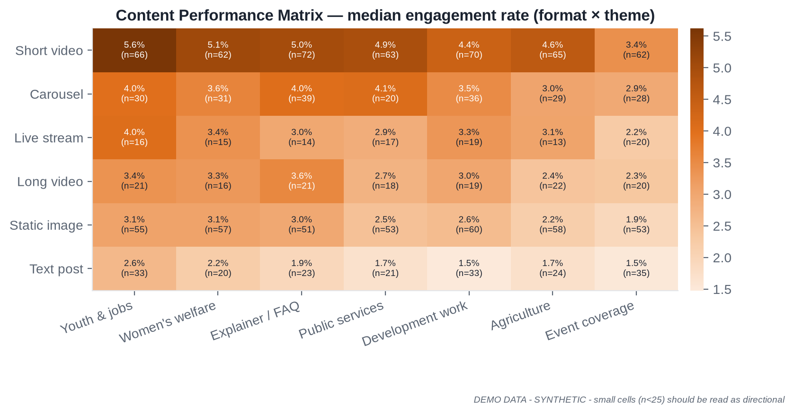

Use: **format and theme planning at aggregate level** (e.g., "short explainer videos on youth employment outperform static images by ~1.8×"). The matrix is **not** used to tailor messages to individuals or sensitive audience segments.

## 21.3 Experiment & test registry (added capability)

Content learning is only reliable when tests are designed up-front.

| Field | Description |
|---|---|
| Hypothesis | e.g., "Hindi captions increase average watch % for 30–60 s explainers" |
| Design | Platform-native A/B (where offered) or matched time-slot rotation |
| Primary metric & MDE | e.g., avg watch %, minimum detectable effect 3 pts |
| Sample/budget | Pre-computed from power analysis |
| Stopping rule | Fixed horizon (no peeking) or sequential test with alpha spending |
| Result | Effect, CI, p-value; decision; learning logged |
| Guardrails | Only content-level variations (format, length, language, time); no targeting on sensitive attributes; all variants compliant (certified/labelled) |

# 22. GIS / Geospatial Intelligence

| Layer | Grain | Source |
|---|---|---|
| Constituency map | AC/PC | Official boundaries where available; community datasets with attribution for analysis; verify delimitation vintage |
| District/block/admin map | District/block | Official/State GIS portals where available |
| Historical result visualisation | AC × election | ECI statistical reports (public) |
| Turnout trends | AC × election | ECI statistical reports |
| Survey coverage | Zone | Survey metadata (counts of interviews; no respondent points) |
| Campaign activity coverage | Zone | Field activity aggregates |
| Event locations | Site (public events only) | Event records |
| Issue distribution | Zone/district | Field issue reports, call-centre categories, geo-attributable public mentions |
| Media distribution | District | Outlet geography |
| Operational coverage | Zone | Field + call-centre aggregates |

**Guardrails:** no individual voter targeting; no household-level plotting; small-area suppression (e.g., hide cells with < 10 records); **maps depicting India's national or state boundaries must use official boundaries (Survey of India) — incorrect external boundaries are a legal risk** [VERIFY exact requirements with legal].

# 23. Reporting

## 23.1 Sample Daily War-Room Report (DEMO DATA)

> **DAILY WAR-ROOM REPORT — Aranyapur AC (FICTIONAL) — Friday 12 September 2026, 07:00 IST**
> *Coverage: 11 Sep 2026 (00:00–23:59). DEMO DATA — SYNTHETIC. Prepared by: AI draft + analyst review (R. Analyst). Approved by: Analytics Lead.*
>
> **1. Executive Summary**
>
> - Overall Campaign Intelligence Health: **74 / 100 (Amber)** — Field domain below target in Hill Block; all other domains green/amber.
> - Social conversation volume is back within its expected range after the 31 Aug water-supply spike; **Jobs & skills** is the fastest-rising issue (+1.8 pts share vs 7-day baseline).
> - Helpline answer rate (84.4%, 7-day) remains **below the 90% SLA** for the second week.
>
> **2. Major Changes (vs trailing 7-day baseline)**
>
> | Signal | Yesterday | Baseline | Assessment |
> |---|---|---|---|
> | Public mentions (de-dup.) | 1,344 | 1,411/day | Within range |
> | Negative share (social) | 41.2% | 40.8% | No significant change |
> | Media items | 122 | 151/day | −19%, within range |
> | Field completion (7-day) | 83.2% | target 85% | Below target (Hill Block 67.4%) |
>
> **3. Digital Performance** — ER 3.49% (+0.18 pts W/W), impressions 9.21 M (+0.9%), video views −3.8% W/W; CPM ₹116 (+4.5%). All boosted items carry certification references.
>
> **4. Social Intelligence** — Top issues by share: Jobs & skills 16.3%, Water supply 14.2%, Prices 12.9%, Roads & transport 12.7%. *Coverage: public posts only; 18% geo-attributable; not representative of the electorate.*
>
> **5. Emerging Issues** — Cluster "skill-centre admissions" (Hinglish, 3 days, growing 2.1× baseline, n = 240) — **Medium**; analyst validated; no misinformation-risk flags.
>
> **6. Media Intelligence** — 122 items; 23.8% negative tone; top topics Roads & transport (18), Prices (17), Jobs & skills (16); regional/hyperlocal share 52.5%.
>
> **7. Survey Movement** — No new wave. Latest (Wave 3, fieldwork 4 Sep, n_eff 3,704): water supply salience 21.0% ± 1.3 (significant rise from 13.0% in Wave 1).
>
> **8. Field Operations** — 1,520 planned activities in last 7 days; 83.2% completed; 79.3% reports on time; bottleneck: Hill Block (Z19–Z24) completion 67.4%. 1,842 local issue reports logged.
>
> **9. Alerts** — 0 Critical · 1 High (helpline SLA breach, open, owner: Call-centre Manager) · 2 Medium (Hill Block completion; X-platform connector latency) · 4 Low.
>
> **10. Data Quality** — 11/14 sources green; 2 amber (X connector latency; field form late submissions); 1 red (regional TV transcripts feed delayed 26 h — vendor notified).
>
> **11. Compliance** — 0 exceptions. 12 paid items live, all certified; 3 AI-assisted items, all labelled with responsible-entity disclosure; no silence period in the next 7 days for this AC.
>
> **12. Recommended Analytical Follow-ups** (operational / analytical only)
> 1. Field Ops to review Hill Block staffing and connectivity; Data team to check whether late reports under-count completion.
> 2. Call-centre Manager to review peak-hour staffing; analytics to break down wait time by hour and language.
> 3. Research to consider adding a skills/training question to Wave 4 to test whether the social trend reflects broader salience.
> 4. Data team to escalate the TV-transcript feed delay with the vendor under the SLA.
>
> *Sources: metric store v1.4; social.mentions_daily; media.mentions_daily; digital.content_daily; field.activity; ops.call_centre; survey.w3. All figures DEMO DATA.*

## 23.2 Weekly Executive Report (10–15 pages)

| Page | Section | Content |
|---|---|---|
| 1 | Executive Summary | 5 key findings, Health Score trend, top risks, decisions requested |
| 2 | KPI Scorecard | Level-2 domain scores and Level-3 KPIs vs targets, W/W and 4-week trend |
| 3 | Trends | Cross-source timeline of the week's major developments |
| 4 | Digital | Scorecard, platform comparison, top/bottom content, spend pacing |
| 5 | Social | Volume, sentiment with CIs, issue shares, emerging clusters, coverage notes |
| 6 | Media | Volume/tone, story threads, regional coverage |
| 7 | Survey | Latest wave, significant changes, sample health, methodology notes |
| 8 | Field | Completion, coverage, bottlenecks, data-submission quality |
| 9 | Geography | Zone/AC maps: activity coverage, issue distribution, survey coverage |
| 10 | Forecast | Next-2-week forecasts with intervals; back-test accuracy |
| 11 | Risks | Operational, data, compliance and reputational risk items with owners |
| 12 | Data Quality | Source health, incidents, fixes |
| 13 | Compliance | Certification, AI labels, spend vs limits, upcoming deadlines |
| 14 | Next-week analytical priorities | Questions to answer, tests to run, data to acquire |
| 15 | Appendix | Definitions, methodology, sources |


# 24. Team Structure & Operating Model

## 24.1 Three staffing scenarios

| Role | A. POC / MVP (5–7) | B. Single constituency / by-election (8–15 core + ops support) | C. Multi-constituency / state (20–50+) |
|---|---|---|---|
| Programme Director | 0.25 (shared) | 0.5 | 1 |
| Product Manager | 1 (combined with PM) | 1 | 1–2 |
| Project Manager | (combined) | 1 | 1–2 |
| Analytics Lead | 1 | 1 | 1 + 2–4 domain leads |
| Data Scientists | 1 | 2 | 4–8 |
| Data Analysts | 1 | 2–3 | 6–12 |
| Data Engineers | 1 | 2 | 3–6 |
| BI Developer | 0.5 | 1 | 2–3 |
| ML/NLP Engineer | 1 | 1 | 2–4 |
| GIS Analyst | — | 0.5 | 1–2 |
| Social Listening Analyst | (DA covers) | 1 | 2–4 (by language) |
| Media Intelligence Analyst | — | 1 | 2–4 (by language/region) |
| QA / Data Operations | — | 1 | 2–4 (24×7 rota) |
| Security / Privacy Lead | 0.25 | 0.5 | 1 |
| Political/Communications Liaison (client-side or agency) | Client-nominated | 1 (client/agency) | 1–3 (client/agency) |
| **Core total** | **5–7 FTE** | **~12–15 FTE** | **~32–60 FTE** |
| Operations support (not core) | — | Survey vendor, field-form ops, call-centre (client) | Plus 24×7 war-room shifts, language annotators |

## 24.2 Role cards

| Role | Responsibilities | Required skills | Daily outputs | Tools | Experience |
|---|---|---|---|---|---|
| **Program Director** | Accountable for outcomes, client relationship, risk, commercial | Programme leadership, analytics delivery, stakeholder management, ethics judgement | Leadership stand-up, risk log review, escalation decisions | Roadmap, RAID log | 15+ yrs |
| **Product Manager** | Owns requirements, backlog, UX, acceptance | Product discovery, analytics products, UX | Prioritised backlog, user feedback synthesis | Jira/Linear, Figma | 8+ yrs |
| **Project Manager** | Plan, dependencies, status, vendor coordination | Delivery management, agile | Status report, dependency tracker | Jira, MS Project | 6+ yrs |
| **Analytics Lead** | Analytical quality, KPI framework, report sign-off | Statistics, storytelling, domain knowledge | Approved daily report, KPI changes | SQL, Python, BI | 10+ yrs |
| **Data Scientist** | Statistics, survey analytics, forecasting, NLP, model validation, AI analytics | See §24.3 | Analyses, model runs, insight notes | Python, SQL, statsmodels, sklearn, Transformers | 4–10 yrs |
| **Data Analyst** | Dashboards QA, ad-hoc analysis, report drafting, data checks | SQL, BI, Excel, domain | Report sections, analysis tickets | SQL, Power BI, Python | 2–6 yrs |
| **Data Engineer** | Connectors, pipelines, warehouse, quality tests, lineage | Python, SQL, dbt, orchestration, cloud | Pipeline health, new sources, fixes | Dagster/Airflow, dbt, Postgres/BigQuery | 4–8 yrs |
| **BI Developer** | Dashboards, semantic model, RLS, performance | Power BI/React, DAX/TS, data viz | Dashboard releases | Power BI / Next.js | 4–8 yrs |
| **ML/NLP Engineer** | Multilingual models, embeddings, RAG, serving, monitoring | Transformers, Indic NLP, MLOps | Model releases, eval reports | PyTorch, HF, FAISS/pgvector, FastAPI | 4–8 yrs |
| **GIS Analyst** | Boundaries, geocoding (aggregate), map layers | GIS, spatial SQL, cartography | Map layer updates | QGIS, PostGIS | 3–6 yrs |
| **Social Listening Analyst** | Monitor public conversation, validate clusters, annotate | Languages, platforms, critical reading | Social section of report, validated alerts | Listening tool, Command Center | 2–5 yrs |
| **Media Intelligence Analyst** | Monitor media, story threads, summaries | Languages, media landscape | Media section, story log | Media monitoring feed | 2–5 yrs |
| **QA / Data Operations** | Data checks, pipeline monitoring, 24×7 triage | SQL, runbooks | Data-quality log, incident tickets | Monitoring, ticketing | 2–5 yrs |
| **Security / Privacy Lead** | Security architecture, DPDP alignment, access reviews, incidents | Cloud security, privacy law familiarity | Access review, security findings | IdP, SIEM, KMS | 8+ yrs |
| **Political / Communications Liaison** | Translates leadership questions into analytical asks; context for interpretation; ensures ethical scope | Campaign communications, ethics, domain | Question backlog, context notes | Command Center, AI Analyst | 8+ yrs |

## 24.3 The Data Scientist role — in detail

> **"A Data Scientist is not just someone who builds ML models; the role is to convert data into statistically defensible decision-support."**

| # | Contribution | What it looks like in this programme |
|---|---|---|
| 1 | Statistical analysis | Period comparisons with proper tests; effect sizes rather than raw differences |
| 2 | Survey analysis | Weighting (raking), design effects, MoE, significance, cross-tab suppression |
| 3 | Trend detection | Rolling baselines, change-point detection, seasonality adjustment |
| 4 | Forecasting | Issue/media/digital/ops forecasts with intervals; back-testing |
| 5 | Anomaly detection | Robust thresholds, false-positive tuning with war-room feedback |
| 6 | NLP | Taxonomy design with analysts; model selection; code-mixed text handling |
| 7 | Sentiment analysis | Gold-set design, per-language validation, calibration |
| 8 | Topic modelling | Embedding clustering, coherence checks, analyst-in-the-loop naming |
| 9 | Content-performance analysis | Format × theme matrix, driver regression, confounder checks |
| 10 | Experiment analysis | Power analysis, pre-registration, correct stopping rules |
| 11 | Attribution / measurement (where valid) | Only with experimental or quasi-experimental designs; no over-claiming from last-click data |
| 12 | KPI modelling | Metric definitions, composite index design and sensitivity analysis |
| 13 | Model validation | Hold-outs, rolling-origin evaluation, calibration |
| 14 | Uncertainty estimation | Bootstrap, analytical CIs, prediction intervals |
| 15 | Data-quality analysis | Quantifying coverage/duplication; impact of quality issues on conclusions |
| 16 | Executive insights | Plain-language "what changed / how sure are we / what to check next" |
| 17 | AI-agent development | Tool definitions for the AI Analyst; guardrails; evaluation sets |
| 18 | RAG analytics | Retrieval quality (recall@k, citation validity), chunking strategies |
| 19 | Automated reporting | Parameterised report generation from the metric store |
| 20 | Model monitoring | Drift, performance decay, alert precision |
| 21 | Bias checks | Per-language/per-region performance; survey representativeness |
| 22 | Reproducibility | Version-controlled code, pinned environments, data snapshots, seeds |
| 23 | Documentation | Model cards, analysis notes, methodology appendices |

**A day in the life (campaign phase):** 06:30 pipeline and alert review → 07:00 daily report sign-off with Analytics Lead → 09:00 war-room stand-up → deep-dive analysis on an open question (e.g., "is the helpline dip driven by language mix?") → model monitoring check → 16:00 insight note to leadership → evening: gold-set review with annotators.

## 24.4 Operating rhythm

| Cadence | Forum | Output |
|---|---|---|
| Daily 07:00 | Daily War-Room Report published | Report + alerts |
| Daily 09:00 | War-room stand-up (15 min) | Actions and owners |
| Twice weekly | Data-quality & model review | Fixes, recalibrations |
| Weekly | Executive review (45 min) | Weekly report, decisions |
| Fortnightly | Governance board (data, privacy, compliance) | Approvals of new sources/purposes/models |
| Monthly | Commercial & roadmap review | Scope changes, cost report |

## 24.5 SLAs (indicative — Professional tier)

| Service | SLA |
|---|---|
| Daily report | Published by 08:00 IST, 7 days/week in campaign phase |
| Critical alert acknowledgement | ≤ 15 min (24×7 in high-intensity phase; business hours otherwise) |
| Dashboard availability | 99.5% monthly |
| Priority source freshness | ≤ 60 min where source permits |
| Ad-hoc analysis request | Standard: 2 business days; urgent: same day (capped per week) |
| Incident response (P1) | Engage ≤ 30 min; status updates hourly |

## 24.6 Escalation matrix

| Level | Trigger | Who | Time |
|---|---|---|---|
| L1 | Alert raised / data issue | On-duty analyst / Data Ops | Immediate |
| L2 | High alert unresolved 1 h; pipeline down > 1 h; client-visible error | Analytics Lead / Data Engineering Lead | ≤ 1 h |
| L3 | Critical alert; compliance exception; security incident; SLA breach | Programme Director + Security/Privacy Lead + Client Compliance Officer | ≤ 30 min |
| L4 | Legal/regulatory exposure; data breach; major reputational risk | Agency leadership + Campaign legal counsel | Immediate |

## 24.7 Business continuity (added capability)

Poll-week runbooks cover: cloud-region incident (warm standby), connector/API outage (manual file-drop fallback), LLM provider outage (AI Analyst degrades to dashboards + templated summaries), key-person absence (cross-trained pairs), power/network failure at war-room (remote access with MFA, mobile hotspots), and vendor feed delays (SLA escalation and coverage banners).

# 25. Proof of Concept (4–6 weeks)

## 25.1 Plan

| Week | Focus | Deliverables |
|---|---|---|
| **1** | Data discovery · source mapping · architecture · KPI definition | Source Registry v1; data-access status per platform (verified); architecture decision record; KPI tree & metric definitions v1; RBAC matrix; POC success criteria signed |
| **2** | Data ingestion · cleaning · database · first dashboard | Pipelines for 6+ sources (synthetic + authorised samples); quality tests; PostgreSQL model; Executive Overview v1 |
| **3** | Social/NLP pipeline · survey analytics · historical analytics | Language ID, topic, sentiment models with gold-set metrics; survey engine (weights, MoE, significance); ECI historical results layer |
| **4** | AI Analyst · alerts · automated reporting | AI Analyst with tools + RAG + citations; alert engine (4 levels); auto-drafted daily report |
| **5** | Validation · security · UX improvements | Model validation report; hallucination/red-team test results; SSO/MFA/RBAC; audit logs; usability fixes |
| **6** | Executive demo · documentation · handover | Live demo; model cards; data dictionary; runbooks; production recommendation & plan |

A 4-week "fast" variant compresses weeks 5–6 into weeks 3–4 by limiting scope to 4 modules.

## 25.2 Demo scenario — fictional constituency

- **Aranyapur AC (FICTIONAL)**: 4 blocks (North, River, Market, Hill), 24 zones (Z01–Z24), six-week window (1 Aug–11 Sep 2026).
- **100,000 synthetic records** (no real voter database): 60,000 public-style social mentions; 6,000 media items; 12,000 anonymous survey responses in 3 waves; 9,000 field activities; 1,500 owned content posts with performance and spend; 11,500 call-centre operational records.
- **Embedded storyline** for the demo: a synthetic water-pipeline outage on 31 Aug produces a social spike, a regional media surge, a helpline service dip and a significant rise in survey salience — showing how the Command Center links signals across sources.
- Every screen and export carries the label **"DEMO DATA — SYNTHETIC"**. Generator: `demo/generate_synthetic_data.py` (seeded, reproducible); charts: `demo/build_charts.py`.

## 25.3 Technology POC architecture

```
          ┌─────────────────────────── Scheduled ETL (Dagster/cron) ───────────────────────────┐
 Sources ─┤  CSV/API samples ─► raw (object store) ─► quality tests ─► dbt models (PostgreSQL)   │
          └───────────────────────────────────────────┬─────────────────────────────────────────┘
                                                      │
          NLP pipeline (Python: LID → normalise → topic/sentiment/NER → embeddings (SentenceTransformers))
                                                      │                         │
                                             PostgreSQL + metric views    pgvector / FAISS index
                                                      │                         │
                                  FastAPI service (RBAC via SSO token, audit middleware)
                                                      │
                          ┌───────────────────────────┼─────────────────────────────┐
                    Power BI / React UI        LLM + tool router (AI Analyst)   Report generator (PDF/PPTX)
```

**Conceptual API endpoints** (full sketch in `poc/openapi.yaml`):

| Method | Endpoint | Returns |
|---|---|---|
| GET | `/dashboard/overview` | Health score, domain scores, KPI strip, top changes, data-as-of |
| GET | `/social/trends?from&to&topic&platform&language` | Daily volume, anomaly flags, sentiment with CIs, coverage index |
| GET | `/media/intelligence?from&to` | Volume by outlet type, tone, issues, story threads |
| GET | `/survey/summary?wave&question` | Weighted estimates, MoE, n, n_eff, significance vs previous wave |
| GET | `/field/operations?block&zone` | Completion, coverage, on-time, bottlenecks |
| GET | `/digital/scorecard?period` | Scorecard metrics vs prior period and targets |
| GET | `/alerts?severity&status` | Alert queue |
| POST | `/alerts/{id}/ack` | Acknowledge/escalate/close with note |
| GET | `/compliance/items?status` | Content items with approval/certification/label status |
| GET | `/data-quality/sources` | Source registry health |
| GET | `/metrics/{metric_id}` | Metric definition + values (metric store) |
| POST | `/ai/query` | Answer with facts, interpretation, citations, data-as-of, confidence |
| GET | `/reports/daily/{date}` | Rendered daily report |
| GET | `/lineage/{metric_id}` | Source-to-metric lineage |

## 25.4 POC acceptance criteria (measurable)

| # | Criterion | Test | Pass threshold |
|---|---|---|---|
| AC-01 | Dashboard loads successfully | Scripted load of 6 POC modules, 20 runs | P95 < 3 s; 0 errors |
| AC-02 | Data refresh works | Scheduled ETL over 5 consecutive days | ≥ 99% job success; freshness SLA met |
| AC-03 | Source lineage available | Random 10 KPI tiles traced to source | 10/10 traceable |
| AC-04 | NLP pipeline works end-to-end | Process 50k texts | ≥ 99% processed; throughput documented |
| AC-05 | Sentiment validated on test set | Held-out gold set (≥ 500/lang for Hindi, English, Hinglish) | Macro-F1 ≥ 0.70 per language; report per class |
| AC-06 | Issue detection works | Back-test on injected/known events | Detects ≥ 90% of labelled events; ≤ 6 h lag; precision ≥ 60% |
| AC-07 | AI Analyst answers only from approved data | 60-question eval set incl. 15 out-of-scope/red-team | ≥ 95% grounded answers; 100% correct refusals on policy-violating prompts; 0 fabricated numbers |
| AC-08 | Citations displayed | Same eval set | 100% of factual answers carry ≥ 1 valid citation and data-as-of |
| AC-09 | Role-based access works | Test users for 4 roles | 0 unauthorised data exposures in 40 test cases |
| AC-10 | Audit logs work | Logins, queries, exports, AI prompts, approvals | 100% of test events captured, immutable |
| AC-11 | Report generation automated | Daily report for 5 days | Auto-draft ≥ 70% of sections; analyst edit time ≤ 30 min |
| AC-12 | Alerts trigger correctly | Synthetic scenarios (spike, pipeline failure, missing AI label, spend threshold) | 100% trigger at correct severity; ≤ 5 min latency |
| AC-13 | Model metrics documented | Model registry | Model card for every POC model |

**POC success = all Must criteria (AC-01–AC-10, AC-12) met and ≥ 2 of 3 remaining; leadership usability score ≥ 4/5.**

# 26. Roadmap

## 26.1 30 / 60 / 90 days (post-POC production)

| Horizon | Theme | Outcomes |
|---|---|---|
| **Day 0–30** | **Foundation** | Production cloud (Indian region), SSO/MFA/RBAC, Source Registry, 10–15 sources live, metric store v1, Executive Overview + Digital + Social + Field modules, daily report automated, governance board running |
| **Day 31–60** | **Intelligence** | Media, Survey, Issue, Geographic modules; multilingual NLP expanded to target regional languages; alert engine tuned; experiment registry; compliance control tower v1 |
| **Day 61–90** | **AI + Automation + Command Center** | AI Analyst GA with evaluation harness; RAG library; forecasting module; weekly report automation; war-room screens; DR test; pen-test; adoption KPIs |

## 26.2 Election-cycle roadmap

| Phase | Analytics focus | Compliance & operations focus |
|---|---|---|
| **Pre-campaign** (months before notification) | Baselines: historical results, public indicators, issue baselines, digital benchmarks; survey Wave 0; taxonomy & gold sets | Source authorisations, DPAs, consent notices, RBAC, policies, training |
| **Campaign** (after announcement/MCC) | Daily reports, alerts, content learning, field coverage, media monitoring | MCC-aware workflows; MCMC certification tracking; AI-label ledger; spend tracking |
| **High-intensity phase** (final weeks) | Intraday refresh on priority sources; 24×7 war-room; tighter alert SLAs | Takedown SLA timers; heightened security monitoring; DR warm standby |
| **Final phase** (48-hour silence window per phase) | Internal monitoring continues; **no publishing workflows**; operational analytics only | Silence-period calendar guard active; paid items verified paused; exit-poll window restrictions |
| **Poll day** | Operational analytics only: helpline service levels, field logistics status, incident logs, media/social monitoring for misinformation-risk (human-verified, routed to legal/comms and official channels) | Full compliance; no election-matter publication in restricted windows; incident escalation matrix at L3/L4 readiness |
| **Post-poll** | Measurement: campaign operations review, content learnings, forecast accuracy review, data-quality retrospective | Expenditure statement support (digital spend reconciliation), record retention, data deletion per schedule, lessons-learned report |


# 27. ROI / Value Framework

We do **not** claim "we will guarantee victory". We measure what the platform can credibly change: speed, quality, visibility and learning.

| Value driver | KPI | Baseline method (Week 1) | Target (Day 90) |
|---|---|---|---|
| Reporting time | Analyst hours to produce daily + weekly reports | Time-and-motion on current process | −60% |
| Manual work | % of recurring report content auto-generated | Report audit | ≥ 70% |
| Issue detection speed | Median lag onset → alert (back-tested on known past incidents) | Reconstruct past incidents | ≤ 2 h for priority sources |
| Data quality | Sources with automated tests; quality score | Source audit | 100%; avg score ≥ 85 |
| Decision cycle | Time from signal to assigned owner/action | War-room log | ≤ 4 h for High/Critical |
| Dashboard adoption | Weekly active named users; AI Analyst queries/user | — | ≥ 80% WAU |
| Content learning | Documented tests with valid results; learnings applied | Experiment registry | ≥ 2 valid tests/week (Professional) |
| Operations visibility | % of planned field activities with structured reports | Field audit | ≥ 95% |
| Media coverage | % of priority outlets/languages monitored | Outlet list | ≥ 90% |
| Model accuracy | Per-language F1; forecast MAPE; interval coverage | Gold sets / back-tests | Meets model-card thresholds |
| Report automation | Automated reports on schedule | — | 100% on-time |
| Compliance assurance | Paid items with certification ref; AI items labelled | Compliance audit | 100% |

**Illustrative efficiency value (not a revenue claim):** if 6 analysts currently spend ~3 hours/day compiling reports, a 60% reduction releases ~11 analyst-hours/day for analysis — roughly 1.4 FTE redeployed to higher-value work.

# 28. Commercial Model

> **Indicative only; the final commercial proposal depends on constituency, election timeline, data availability, staffing, SLA and technology requirements.** All figures in INR, exclusive of GST; third-party pass-through at cost plus a disclosed handling fee.

## 28.1 Cost components

| # | Component | What it covers | Pricing basis |
|---|---|---|---|
| 1 | **One-time setup** | Discovery, architecture, cloud landing zone, connectors, data model, metric store, dashboards, security set-up, training | Fixed fee by tier |
| 2 | **POC** | 4–6 week proof of concept (§25) | Fixed fee; 50% creditable against setup if contracted within 30 days |
| 3 | **Monthly analytics retainer** | Named team, operating rhythm, daily/weekly reports, analysis, model upkeep | Monthly by tier / FTE mix |
| 4 | **Technology/platform fee** | Platform licence/IP use, maintenance, upgrades, support | Monthly |
| 5 | **Cloud/API** | Cloud compute/storage, LLM tokens, paid APIs (e.g., X API credits), map services | Pass-through + handling fee; monthly budget caps |
| 6 | **Survey/data vendor** | CATI/F2F/online survey waves; social-listening and media-monitoring licences; broadcast transcripts | Vendor quotes, passed through |
| 7 | **Field operations enablement** | Form app configuration, training, field data-ops support (field staff themselves are client-side unless separately scoped) | Setup + monthly |
| 8 | **24×7 war-room support** | Shift-based analysts, on-call engineering in high-intensity phase | Per pod per month |
| 9 | **Custom AI development** | New models, agents, integrations beyond tier scope | Per sprint or rate card |
| 10 | **Travel / on-site support** | War-room presence, workshops | At actuals, pre-approved |

## 28.2 Three commercial tiers (indicative bands)

| | **Starter** | **Professional** | **Enterprise** |
|---|---|---|---|
| Typical scope | 1 AC or by-election; 8–12 weeks | 1 PC or up to ~10 ACs; 3–6 months | Multi-constituency / state; 6–12 months |
| Modules | Executive, Digital, Social, Field, Alerts, Daily report, AI Analyst (basic) | All 14 modules; compliance tower; forecasting; experiments | All + custom models, multi-language expansion, multi-tenant views |
| Team (core FTE) | 6–8 | 12–15 | 30–60 |
| Support | Business hours + on-call for Critical | Extended hours; 24×7 in final 2 weeks | 24×7 war-room throughout campaign phase |
| **1. One-time setup** | ₹15–30 lakh | ₹40–80 lakh | ₹1.2–3.0 crore |
| **2. POC** (if taken) | ₹18–35 lakh | ₹18–35 lakh | ₹25–45 lakh (broader discovery) |
| **3. Monthly analytics retainer** | ₹12–22 lakh | ₹30–50 lakh | ₹0.8–2.0 crore |
| **4. Technology/platform fee** (monthly) | ₹1.5–3 lakh | ₹4–8 lakh | ₹10–25 lakh |
| **5. Cloud/API** (monthly, pass-through est.) | ₹0.5–1.5 lakh | ₹2–6 lakh | ₹8–30 lakh |
| **6. Survey/data vendor** | Per vendor quote (see 28.3) | Per quote | Per quote |
| **7. Field ops enablement** | ₹2–4 lakh setup | ₹4–8 lakh setup + ₹1–2 lakh/month | Scoped |
| **8. 24×7 war-room** (per pod/month) | Optional ₹8–12 lakh | ₹10–15 lakh | Included (sized by pods) |
| **9. Custom AI development** | Rate card | ₹5–9 lakh per 2-week sprint | Dedicated pod |
| **10. Travel/on-site** | At actuals | At actuals | At actuals |

## 28.3 Third-party cost guidance (to be validated with vendor quotes)

| Item | Indicative band | Note |
|---|---|---|
| CATI survey | ~₹250–600 per complete | Length, language, incidence dependent **[VERIFY]** |
| Face-to-face (tablet) survey | ~₹450–1,200 per complete | Geography and sampling design dependent **[VERIFY]** |
| Social-listening licence | ~₹1–10 lakh/month | Volume, platforms, languages |
| Media monitoring (print/online) | ~₹1–5 lakh/month | Outlets and languages |
| Broadcast transcripts (licensed) | ~₹2–8 lakh/month | Channels and hours |
| LLM usage | Capped per user/day; typically a small share of cloud/API | Token budgets enforced |
| X API | Pay-per-use credits (reported since Feb 2026) | Budget cap and read limits required |

## 28.4 Rate card (for change requests; per person-day, indicative)

| Role | ₹/day |
|---|---|
| Programme Director | 35,000–50,000 |
| Analytics Lead / Security & Privacy Lead | 20,000–28,000 |
| Senior Data Scientist / ML-NLP Engineer | 16,000–25,000 |
| Data Scientist / Data Engineer | 12,000–18,000 |
| Product / Project Manager | 12,000–18,000 |
| BI Developer / GIS Analyst | 10,000–14,000 |
| Data Analyst | 7,000–11,000 |
| Social / Media Intelligence Analyst | 6,000–9,000 |
| QA / Data Operations | 5,000–8,000 |

## 28.5 Worked example (Professional, 4 months, indicative)

| Line | Calculation | Indicative |
|---|---|---|
| Setup | one-time | ₹60 lakh |
| Retainer | 4 × ₹40 lakh | ₹1.60 crore |
| Platform fee | 4 × ₹6 lakh | ₹24 lakh |
| Cloud/API | 4 × ₹4 lakh | ₹16 lakh |
| Survey | 2 waves × ~₹20 lakh | ₹40 lakh |
| War-room pod | 1 month | ₹12 lakh |
| Travel | estimate | ₹5 lakh |
| **Total** | | **≈ ₹3.17 crore** (range roughly ₹2.3–4.5 crore) |

## 28.6 Cost guardrails (added capability)

Monthly cost report by component; per-module cloud budgets with alerts at 80%/100%; LLM token caps per user/day; approval required for new paid data sources; pass-through invoices shared transparently.

# 29. Client Dependency Checklist

| # | Dependency | Needed by | Owner (client/agency) |
|---|---|---|---|
| 1 | Campaign scope (objectives, questions leadership wants answered) | Week 1 | Agency lead |
| 2 | Geography (states, PCs/ACs, sub-units) | Week 1 | Agency lead |
| 3 | Timeline (key dates, expected phases) | Week 1 | Agency lead |
| 4 | Existing data inventory and samples | Week 1 | Team leads |
| 5 | API access / admin authorisation for owned accounts | Week 1–2 | Digital lead |
| 6 | Dashboard / BI tool access (if reusing) | Week 1 | IT |
| 7 | Survey data, questionnaires, methodology, weights | Week 2 | Research lead |
| 8 | Authorised first-party data with lawful-basis evidence | Week 2 | Data owner + legal |
| 9 | Field report formats and access to the field app | Week 2 | Field head |
| 10 | Media-monitoring access/licences | Week 2 | Media cell |
| 11 | Compliance contact (named) | Week 1 | Agency |
| 12 | Legal contact (named) | Week 1 | Campaign |
| 13 | Cloud preference and accounts | Week 1 | IT |
| 14 | Security requirements (IdP, device policy, residency) | Week 1 | IT/security |
| 15 | Reporting cadence and distribution list | Week 1 | Leadership office |
| 16 | Decision-makers and approval matrix | Week 1 | Leadership office |
| 17 | SLA expectations and support hours | Week 1 | Agency lead |
| 18 | Issue taxonomy input and language priorities | Week 1–2 | Research + comms |
| 19 | Annotators / language reviewers (or approval to use Partner annotators) | Week 2 | Agency |
| 20 | Brand assets **with authorisation** (if any official marks are to be used) | Before external use | Agency |

# 30. Risk Register

Scale: Probability and Impact 1 (low) – 5 (high). Score = P × I.

| # | Risk | P | I | Score | Mitigation | Owner |
|---|---|---|---|---|---|---|
| R1 | Poor data quality (late, incomplete, inconsistent) | 4 | 4 | 16 | Quality gates, source scorecards, badges on tiles, data-ops rota | Data Eng Lead |
| R2 | Incomplete or unavailable APIs | 4 | 3 | 12 | Week-1 verification; file-drop fallbacks; licensed vendors | Data Eng Lead |
| R3 | Platform restrictions / policy changes | 3 | 4 | 12 | Vendor diversity; contractual review; monitor developer changelogs | Product Manager |
| R4 | Biased surveys (sampling, non-response, mode) | 3 | 4 | 12 | Design review, weighting, QC, benchmark checks, AAPOR-style disclosure | Research Lead / DS |
| R5 | Social-media non-representativeness | 5 | 3 | 15 | Coverage index; mandatory caveats; triangulation with survey/field | Analytics Lead |
| R6 | Model drift | 3 | 3 | 9 | Monitoring, monthly re-validation, gold-set refresh | ML Lead |
| R7 | LLM hallucination | 3 | 5 | 15 | Tool-first answers, numeric/citation checks, eval harness, refusal policy | ML Lead |
| R8 | Overfitting (short histories) | 3 | 3 | 9 | Simple baselines, rolling-origin validation, parsimony | DS Lead |
| R9 | False-positive alerts (alert fatigue) | 4 | 2 | 8 | Thresholds tuned with feedback; grouping; precision KPI | Analytics Lead |
| R10 | False-negative alerts (missed issues) | 3 | 4 | 12 | Multi-signal rules; back-tests; analyst scanning | Analytics Lead |
| R11 | Compliance risk (uncertified ads, unlabelled AI, silence period) | 3 | 5 | 15 | Control tower rules; blocking states; legal sign-off | Compliance Officer |
| R12 | Privacy risk (excess personal data, purpose creep) | 3 | 5 | 15 | Minimisation, permitted-use tags, DPIA-style review, audits | Privacy Lead |
| R13 | Cyber risk (breach, credential theft, insider) | 3 | 5 | 15 | SSO/MFA, least privilege, logging, pen-test, DLP, IR runbook | Security Lead |
| R14 | Unrealistic client expectations | 4 | 4 | 16 | "What we will not promise" in contract; acceptance criteria; education | Programme Director |
| R15 | Vendor/API cost overrun | 3 | 3 | 9 | Budget caps; monthly cost report | Project Manager |
| R16 | Key-person dependency | 3 | 3 | 9 | Cross-training; documentation; bench | Programme Director |
| R17 | Reputational risk from misuse of outputs | 2 | 5 | 10 | Scope guardrails; refusal policy; audit logs; ethics escalation | Programme Director |
| R18 | Regulatory change mid-campaign | 3 | 4 | 12 | Legal watch; configurable rules engine | Compliance Officer |

**Heat view:**

| Impact ↓ / Probability → | 1–2 | 3 | 4–5 |
|---|---|---|---|
| **5** | R17 | R7, R11, R12, R13 | — |
| **4** | — | R3, R4, R10, R18 | R1, R14 |
| **3** | — | R6, R8, R15, R16 | R2, R5 |
| **2** | — | — | R9 |

# 31. What We Should Not Promise

| We will **not** promise | Why |
|---|---|
| Guaranteed election outcome | Outcomes depend on factors far outside analytics |
| Exact vote prediction | Not statistically defensible; restricted publication windows; not in scope |
| Complete voter-preference prediction | Neither possible nor ethical at individual level |
| Individual political-belief inference | Prohibited by design |
| Unauthorised personal-data access | Unlawful |
| Secret tracking | Unlawful and unethical |
| Illegal scraping | Breaches law and platform terms |
| Private-message monitoring | Unlawful; privacy violation |
| Guaranteed viral content | Platform algorithms and audiences are not controllable |
| Guaranteed persuasion | Out of scope; manipulative framing rejected |
| Guaranteed ROI | We commit to measurable operational KPIs (§27), not outcomes |

# 32. Visual Design & Asset Sourcing

## 32.1 Design direction

A premium political-technology aesthetic that is **professional, not propagandistic**: deep navy/charcoal as the dominant field; saffron as the signal/accent colour; white space; subtle gold for highlights; clean data visualisation; abstract network/"constellation" motifs representing connected data; dashboard mock-ups; no inflammatory imagery, no party symbols, no leaders' photographs.

| Token | Hex | Use |
|---|---|---|
| Deep navy | `#0B1F3A` | Title/closing slides, headers |
| Charcoal ink | `#1B2330` | Body text |
| Saffron | `#E2711D` | Accent, series 1, key numbers |
| Signal blue | `#2F6DB5` | Series 2 |
| Teal | `#1A9A8F` | Series 3 |
| Ochre-gold | `#A67C1A` / `#C9A227` | Series 4 / highlights |
| Light surface | `#F4F6F9` | Cards |

The categorical palette (saffron, blue, teal, ochre) passed an automated colour-vision-deficiency and contrast validation on a light surface.

**Branding rule:** party marks are used **only where the Agency holds written authorisation**; the deck contains a clearly labelled **"[Client logo placeholder — official assets only with authorisation]"** box.

**Map rule:** no India outline is used in the deck; any national/state map in client-facing material must use official Survey of India boundaries.

## 32.2 Visual assets register

| Asset | Source | Licence / usage consideration | Where used |
|---|---|---|---|
| Abstract network cover visual | Generated for this project (`demo/build_charts.py`) | Own work; no third-party rights | Slides 1, 34 |
| All charts (anomaly, sentiment, survey, content matrix, hex map, forecast, media, call-centre) | Generated from synthetic DEMO data | Own work; labelled DEMO DATA | Slides 12–18 and PRD |
| Diagrams, dashboard mock-ups, org charts, roadmap | Drawn natively in PowerPoint | Own work; editable | Slides 2–35 |
| *Optional:* night-lights Earth imagery | NASA Earth Observatory (Black Marble) | NASA imagery is generally not copyrighted but NASA media guidelines apply (no endorsement implied) — **verify per image** | Optional replacement for cover |
| *Optional:* control-room / team photographs | Unsplash / Pexels | Free commercial use under their licences; avoid identifiable people without releases; no implied endorsement | Optional for team slide |
| *Optional:* icons | Google Material Symbols (Apache 2.0) | Attribution in notes | Optional |
| *Optional:* official maps | Survey of India | Official boundaries; terms per SoI | Any national/state map |

No external images were used in the current deck; if suitable images cannot be safely sourced, the generated abstract visuals remain.

# 33. Presentation — Slide-by-Slide Content

The executive deck (`deliverables/Election_Intelligence_Command_Center_Executive_Deck.pptx`, 35 slides) follows this structure:

| # | Slide | Purpose | Key content | Visual |
|---|---|---|---|---|
| 1 | Cover | Set positioning | Title, subtitle, "AI + Data + Digital Intelligence Partner", placeholder logos | Generated network visual |
| 2 | Executive Vision | The idea in one loop | Data → Intelligence → Insight → Decision Support → Measurement → Learning | 6-node loop |
| 3 | Why Campaign Intelligence Matters | Urgency | 4 regulatory/operational shifts of 2025–26 | Stat cards with dates |
| 4 | The Current Problem | Pain | Fragmented workflows; 6 blind spots | Current-state diagram |
| 5 | Our Solution | Before/after | Current vs future state | Two-column comparison |
| 6 | Command Center Concept | Product | 9 capability pillars on one intelligence layer | Layered pillars |
| 7 | Data Ecosystem | Breadth with discipline | Six source families A–F | 6 cards |
| 8 | Data Sources & Access Reality | Honesty on APIs | Platform-by-platform access status to verify | Status table |
| 9 | Data Architecture | Engineering | Sources → … → Command Center | Pipeline diagram |
| 10 | Data Model & Analytics Stack | Structure | Conceptual ERD + 4 analytics levels | ERD + ladder |
| 11 | AI / NLP Layer | Multilingual intelligence | Listening → NLP → Topic → Sentiment → Trend → Alert | Flow + language chips |
| 12 | Social Intelligence | Demo | Anomaly chart + coverage caveat | Chart |
| 13 | Media Intelligence | Demo | Weekly outlet mix + modules | Chart |
| 14 | Survey Intelligence | Rigour | Weighted CIs; methodology controls | Chart |
| 15 | Digital Analytics | Scorecard | Scorecard + content matrix | Chart + KPI cards |
| 16 | Field & Call-centre Operations | Operations | KPIs + service levels | Chart + cards |
| 17 | GIS Intelligence | Geography | Zone map + layers + guardrails | Hex map |
| 18 | Forecasting & ML | Honest prediction | Forecast with intervals + model card | Chart + card |
| 19 | AI Analyst | Grounded AI | Architecture + sample answer with citations | Diagram + chat mock |
| 20 | Real-Time Alerts | Early warning | 4 levels, SLAs, examples | Severity ladder |
| 21 | Executive Dashboard | The product | Health score + domain chips + KPI strip | Dashboard mock-up |
| 22 | Compliance Control Tower | Auditability | Status table + regulatory anchors | Tower mock-up |
| 23 | Security & Governance | Trust | Controls grid | Shield grid |
| 24 | Responsible AI | Ethics | Principles + three kinds of AI | Three-column |
| 25 | Team Structure | Delivery | Three scenarios | Org chart |
| 26 | The Data Scientist Role | Depth | 23 contributions in 5 clusters | Cluster cards |
| 27 | POC Plan | Next step | 6-week plan + acceptance | Gantt |
| 28 | Technology POC | Build | Stack + endpoints | Architecture + endpoint list |
| 29 | Roadmap | Horizon | 30/60/90 + election cycle | Timeline |
| 30 | Commercial Model | Investment | Three tiers | Tier table |
| 31 | KPIs & Value | Measurable outcomes | KPI tree + value metrics | Tree + cards |
| 32 | Risks & Mitigation | Candour | Top risks heat map | Matrix |
| 33 | Boundaries & Dependencies | Expectations | What we won't promise; what we need | Two columns |
| 34 | From Campaign Data to Campaign Intelligence | Close | Platform · Team · Technology · Governance · Outcomes | Network visual |
| 35 | Sources & Notes | Credibility | Key sources, disclaimers | List |

# 34. Critical Self-Review & Red-Team

## 34.1 "What important capabilities have we missed?" — checklist result

| Capability | Covered in | Status |
|---|---|---|
| Data governance | §9 | ✓ |
| Privacy | §9, §16, §17 | ✓ |
| Cybersecurity | §16 | ✓ |
| Data lineage | §9, §11, AC-03 | ✓ |
| Data quality | §6, §9, §18 (screen 12) | ✓ |
| Model governance | §17.3 | ✓ |
| AI hallucination protection | §15.5 | ✓ |
| Multilingual NLP | §14.2 | ✓ |
| GIS | §22 | ✓ |
| Survey methodology | §8.3, §13.4 | ✓ |
| Media intelligence | §13.3 | ✓ |
| Digital analytics | §21 | ✓ |
| Field operations | §13.5 | ✓ |
| Call-centre analytics | §13.6 | ✓ |
| Anomaly detection | §14 (M8), §19 | ✓ |
| Forecasting | §14 (M7, M9), §17.3 | ✓ |
| Experiment measurement | §21.3 | ✓ (added) |
| Automated reporting | §23 | ✓ |
| Executive dashboards | §18 | ✓ |
| Compliance | §10 | ✓ |
| AI-content labelling | §10.2, §17.2 | ✓ |
| Audit trails | §9, §10, §16 | ✓ |
| Disaster recovery | §7, §16 | ✓ |
| Business continuity | §24.7 | ✓ (added) |
| Vendor/API dependency | §8.4, §9, R2/R3 | ✓ |
| Cost management | §28.6 | ✓ (added) |
| Staffing | §24 | ✓ |
| SLA | §24.5 | ✓ |
| Escalation matrix | §24.6 | ✓ (added) |
| Client dependencies | §29 | ✓ |
| POC success criteria | §25.4 | ✓ |
| Acceptance criteria | §25.4 | ✓ |

## 34.2 Red-team review

| Lens | Finding | Action taken |
|---|---|---|
| **Technical feasibility** | Real-time social listening at scale depends on paid, permitted access — not free APIs | API reality table; licensed vendors; file-drop fallbacks; "verify" tags |
| | Hinglish/romanised text breaks off-the-shelf sentiment models | Normalisation + per-language gold sets + thresholds |
| | 6-week POC risks over-scope | 6 modules in POC; others on roadmap; 4-week variant defined |
| **Legal/compliance** | Several ECI instructions verified through secondary reporting only | Marked [VERIFY]; legal sign-off gate in Week 1 |
| | Exit-poll and silence-period constraints could be breached by automated publishing | Calendar guard blocks publishing workflows and restricted report types |
| | Using party branding without authorisation | Placeholders only; authorisation required |
| | Incorrect India boundaries on maps | No national outline; SoI boundaries required |
| **Privacy** | Call-centre, CRM and field data can contain personal data | Minimisation, pseudonymisation, permitted-use tags, no caller PII in POC |
| | Public social data still contains personal data | Aggregate early; drop handles after de-dup; no individual profiles |
| | "Creator amplification" could drift into profiling individuals | Restricted to public figures/media/organisations, aggregated by account type |
| **AI hallucination** | LLM may invent numbers or sources | Tool-first answers, numeric checker, system-generated citations, eval harness, AC-07/AC-08 |
| | Prompt injection via retrieved documents | Document intake approval; injection filters; red-team suite |
| **Data quality** | Field reports late → under-counted completion | Timeliness KPI; late-report reconciliation; badges |
| | Survey weights unstable with small cells | Trimming; cell suppression; n_eff shown |
| **Unrealistic claims** | Health score could be misread as a win probability | Defined as operational; explicit disclaimer on screen |
| | Synthetic demo metrics (e.g., 2.2% MAPE) look better than reality | Model card states real-world error will be higher |
| **Missing team roles** | Annotators and language reviewers; 24×7 data-ops | Added to scenario C and dependencies |
| **Missing costs** | Listening/media licences, X API credits, annotation, pen-test, DR standby | Added to §28.3 and tiers |
| **Missing dependencies** | Legal contact, annotators, brand authorisation | Added to §29 |
| **Missing POC requirements** | Usability, red-team test, RBAC test users | AC-07, AC-09, usability score |

## 34.3 Additional capabilities added after self-review (and why)

| # | Capability | Why it matters |
|---|---|---|
| 1 | Source & lawful-basis registry with permitted-use tags enforced at query time | Turns purpose limitation from policy into a technical control |
| 2 | Metric store / semantic layer | Ends "whose number is right" debates; AI and dashboards agree |
| 3 | Coverage & Representativeness Index | Prevents over-reading social data |
| 4 | Multilingual gold sets with agreement targets | Makes NLP accuracy measurable per language |
| 5 | Experiment & test registry | Turns content performance into valid learning |
| 6 | Silence-period & exit-poll calendar guard | Hard control on legally restricted windows |
| 7 | AI Content Provenance Ledger | Mirrors ECI record-keeping expectations for AI material |
| 8 | Official-boundary map rule | Avoids a common legal pitfall |
| 9 | Escalation matrix, SLAs, BCP runbooks | Poll-week resilience |
| 10 | Cost guardrails | Prevents API/LLM bill shock |
| 11 | AI red-team & hallucination harness | Evidence that the AI is safe to use |
| 12 | Exit & data-return plan | Client retains control of its data |
| 13 | Health-score "red domain cap" rule | Prevents good news hiding bad news |
| 14 | Late-report reconciliation for field data | Avoids false operational alarms |


# Appendix A — Sources

*Retrieved/checked September 2026. Where the ECI primary document could not be retrieved directly, the reputable report of the ECI press note/advisory is cited and the item is marked [VERIFY] in the body. This appendix does not constitute legal advice.*

## A.1 Legal sources

| ID | Source | Date | Supports |
|---|---|---|---|
| L1 | ECI press note on regulation of political advertising & digital campaigning for 2026 Assembly elections — reported by ANI: https://www.aninews.in/news/national/general-news/eci-mandates-pre-certification-of-political-ads-on-social-electronic-media-ahead-of-elections20260320194334/ ; Akashvani (Prasar Bharati): https://www.newsonair.gov.in/ec-issues-order-to-regulate-political-advertisements-across-electronic-digital-media ; primary: https://www.eci.gov.in (press releases) | 20 Mar 2026 | MCMC pre-certification incl. social media; social-media account disclosure; 75-day expenditure statements incl. internet spend |
| L2 | ECI on pre-certification of political advertisements in print media — Akashvani: https://www.newsonair.gov.in/election-commission-mandates-pre-certification-of-political-advertisements-in-print-media | 6 Apr 2026 | Print-ad pre-certification |
| L3 | ECI advisory on labelling AI-generated/synthetic content — Business Today: https://www.businesstoday.in/india/story/eci-mandates-clear-labelling-of-ai-generated-content-in-political-campaigns-499535-2025-10-24 ; ANI: https://www.aninews.in/news/national/general-news/eci-issues-advisory-to-control-misuse-of-ai-generated-content-during-elections-urges-parties-to-report-fake-accounts-deepfakes20251025015121/ ; Akashvani: https://www.newsonair.gov.in/ec-issues-fresh-guidelines-on-ai-and-synthetic-content-use-in-bihar-poll-campaigns | 24–25 Oct 2025 | Label text, 10% area / first 10% audio, responsible-entity disclosure, records, 3-hour takedown |
| L4 | ECI advisory on labelling synthetic content — Akashvani: https://www.newsonair.gov.in/eci-directs-political-parties-to-label-ai-generated-synthetic-content-in-campaigns ; IndiaAI: https://indiaai.gov.in/article/election-commission-of-india-embraces-ai-ethics-in-campaigning-advisory-on-labelling-ai-generated-content | 16 Jan 2025 | Earlier AI-labelling advisory |
| L5 | ECI guidelines on responsible and ethical use of social media — DD India: https://ddindia.co.in/2024/05/eci-issues-guidelines-for-ethical-social-media-use-in-campaigns/ | 6 May 2024 | Deepfake prohibition; 3-hour removal |
| L6 | ECI reiteration for 2026 elections — SCC Online: https://www.scconline.com/blog/post/2026/04/21/eci-regulates-social-media-during-elections-2026/ ; MediaNama: https://www.medianama.com/2026/04/223-eci-orders-3-hour-takedown-rule-ai-fake-content-elections/ | Apr 2026 | 3-hour takedown; labels; enforcement statistics |
| L7 | ECI instructions on use of social media in election campaigning (25 Oct 2013) — ECI FAQ on Social Media: https://old.eci.gov.in/files/file/13753-faq-on-social-media/ ; Nyaaya explainer: https://nyaaya.org/legal-explainer/social-media-advertisements/ | 2013 (FAQ updated periodically) | MCC applies online; pre-certification; social-media expenditure |
| L8 | IT (Intermediary Guidelines and Digital Media Ethics Code) Amendment Rules, 2026 — Khaitan & Co: https://www.khaitanco.com/thought-leadership/MeitY-notifies-the-IT-Amendment-Rules-2026 ; Freshfields: https://www.freshfields.com/en/our-thinking/blogs/technology-quotient/india-targets-deepfakes-and-ai-generated-content-key-changes-under-meitys-2026-102mjwn ; MeitY FAQ on SGI: https://www.meity.gov.in/static/uploads/2025/10/065b6deb585441b5ccdf8be42502a49c.pdf | Notified 10 Feb 2026; in force 20 Feb 2026 | SGI labelling; 3-hour intermediary takedown |
| L9 | Representation of the People Act, 1951 (ss. 77, 126, 126A) — India Code: https://www.indiacode.nic.in | As amended | Expenditure accounts; silence period; exit-poll restriction |
| L10 | Report of the Committee on Section 126 of the RP Act — ECI: https://eci.gov.in/files/file/9276-report-of-the-committee-on-section-126-of-the-representation-of-the-people-act-1951/ ; PIB: https://www.pib.gov.in/newsite/PrintRelease.aspx?relid=187412 | Jan 2019 | Silence period and digital media; platform code of ethics (3-hour processing) |
| L11 | ECI press release — limits of candidates' expenses enhanced: https://old.eci.gov.in/files/file/13928-limits-of-candidate%E2%80%99s-expenses-enhanced/ | 6 Jan 2022 | ₹95/75 lakh (PC), ₹40/28 lakh (AC) |
| L12 | Digital Personal Data Protection Act, 2023 — MeitY: https://www.meity.gov.in/data-protection-framework | Aug 2023 | Data-protection obligations |
| L13 | DPDP Rules, 2025 — notified 14 Nov 2025; analysis: https://www.amsshardul.com/insight/enforcement-of-the-dpdp-act-and-notification-of-the-dpdp-rules/ ; Rule 6 text: https://www.dpdpa.com/dpdparules/rule6.html | 14 Nov 2025 (phased to 14 May 2027) | Security safeguards, 1-year logs, breach reporting |
| L14 | CERT-In Directions under s.70B(6) IT Act — https://www.cert-in.org.in ; summary: https://www.internetsociety.org/resources/doc/2022/internet-impact-brief-india-cert-in-cybersecurity-directions-2022/ | 28 Apr 2022 (effective 28 Jun 2022) | 6-hour incident reporting; 180-day logs in India |
| L15 | India AI Governance Guidelines — PIB/MeitY: https://static.pib.gov.in/WriteReadData/specificdocs/documents/2025/nov/doc2025115685601.pdf | 5 Nov 2025 | Responsible-AI principles |
| L16 | Meta — Ads about Social Issues, Elections or Politics: https://transparency.meta.com/policies/ad-standards/SIEP-advertising/SIEP/ | Current (checked Sep 2026) | Authorisation and disclaimers |
| L17 | Google — Political content policy: https://support.google.com/adspolicy/answer/6014595 ; India election-ads pre-certificate requirements: https://support.google.com/adspolicy/contact/in_elections_pre_cert_requirements | Current (checked Sep 2026) | Verification; ECI pre-certificate per ad |
| L18 | ECI exit-poll prohibition for 2026 Assembly elections — Newsgram: https://www.newsgram.com/india/2026/04/08/ec-restricts-exit-polls-rpa-1951 | 8 Apr 2026 | Exit-poll window (9–29 Apr 2026) |

## A.2 Technical sources

| ID | Source | Date | Supports |
|---|---|---|---|
| T1 | Meta Graph API documentation: https://developers.facebook.com/docs/graph-api | Current | Page insights access model |
| T2 | Instagram Platform documentation: https://developers.facebook.com/docs/instagram-platform ; Basic Display EOL (4 Dec 2024) | Current | Business/Creator-only APIs |
| T3 | Meta Ad Library tools: https://transparency.meta.com/researchtools/ad-library-tools | Current | Ad Library API, verification |
| T4 | Meta Content Library announcement: https://about.fb.com/news/2023/11/new-tools-to-support-independent-research/ ; CrowdTangle shutdown: https://www.cjr.org/tow_center/meta-is-getting-rid-of-crowdtangle.php | Nov 2023; 14 Aug 2024 | Researcher-only access |
| T5 | YouTube Data API v3: https://developers.google.com/youtube/v3 ; YouTube Analytics API: https://developers.google.com/youtube/analytics | Current | Public metadata; owned-channel analytics |
| T6 | X API pay-per-use announcement: https://devcommunity.x.com/t/announcing-the-launch-of-x-api-pay-per-use-pricing/256476 | 2026 | Pricing model (budget caps) |
| T7 | Google Trends API (alpha): https://developers.google.com/search/blog/2025/07/trends-api | 24 Jul 2025 | Application-gated alpha |
| T8 | GA4 Data API: https://developers.google.com/analytics/devguides/reporting/data/v1 | Current | Website analytics |
| T9 | Google Ads API: https://developers.google.com/google-ads/api/docs/start | Current | Owned ad-account reporting |
| T10 | PostgreSQL: https://www.postgresql.org/docs/ ; pgvector: https://github.com/pgvector/pgvector | Current | Warehouse + vectors |
| T11 | FAISS: https://github.com/facebookresearch/faiss | Current | Vector similarity |
| T12 | dbt: https://docs.getdbt.com/ | Current | Transformations, tests, lineage |
| T13 | Dagster: https://docs.dagster.io/ ; Apache Airflow: https://airflow.apache.org/docs/ | Current | Orchestration |
| T14 | FastAPI: https://fastapi.tiangolo.com/ | Current | API layer |
| T15 | Sentence-Transformers: https://www.sbert.net/ | Current | Embeddings |
| T16 | Power BI row-level security: https://learn.microsoft.com/power-bi/enterprise/service-admin-rls | Current | RLS |
| T17 | OWASP ASVS: https://owasp.org/www-project-application-security-verification-standard/ | Current | App-security baseline |

## A.3 Data sources

| ID | Source | Date | Supports |
|---|---|---|---|
| D1 | ECI Statistical Reports: https://www.eci.gov.in/statistical-reports | Current | Historical results, turnout, electors |
| D2 | PIB — Index Cards and Statistical Reports published on ECINET: https://www.pib.gov.in/PressReleasePage.aspx?PRID=2258991 | 2026 | 72-hour publication for 2026 Assembly elections |
| D3 | TCPD Lok Dhaba (Ashoka University): https://tcpd.ashoka.edu.in/lok-dhaba/ ; https://lokdhaba.ashoka.edu.in/ | Current | Cleaned historical results (licence to confirm) |
| D4 | Census 2027 — PIB document: https://static.pib.gov.in/WriteReadData/specificdocs/documents/2026/apr/doc2026425856601.pdf | 25 Apr 2026 | Census timeline |
| D5 | Open Government Data Platform: https://data.gov.in | Current | Public indicators |
| D6 | DataMeet community maps — Assembly Constituencies: https://projects.datameet.org/maps/assembly-constituencies/ | Current | Boundaries (CC BY 2.5 India; delimitation vintage caveats) |
| D7 | Survey of India: https://surveyofindia.gov.in | Current | Official boundaries |
| D8 | ECINET: https://ecinet.eci.gov.in | Current | ECI unified portal |

## A.4 AI/ML sources

| ID | Source | Supports |
|---|---|---|
| A1 | IndicTrans2 (AI4Bharat, MIT): https://github.com/AI4Bharat/IndicTrans2 | Translation, 22 scheduled languages |
| A2 | IndicBERT (AI4Bharat, MIT): https://huggingface.co/ai4bharat/indic-bert | Indic encoder |
| A3 | MuRIL (Google): https://huggingface.co/google/muril-base-cased | Indic + transliterated encoder (licence to confirm) |
| A4 | Indic NLP Catalog: https://ai4bharat.github.io/indicnlp_catalog/ | Resource discovery |
| A5 | NIST AI Risk Management Framework 1.0: https://www.nist.gov/itl/ai-risk-management-framework | AI risk governance |
| A6 | ISO/IEC 42001:2023: https://www.iso.org/standard/81230.html | AI management systems |
| A7 | Mitchell et al., "Model Cards for Model Reporting": https://arxiv.org/abs/1810.03993 | Model cards |
| A8 | Gebru et al., "Datasheets for Datasets": https://arxiv.org/abs/1803.09010 | Dataset documentation |
| A9 | Lewis et al., "Retrieval-Augmented Generation": https://arxiv.org/abs/2005.11401 | RAG |
| A10 | Grootendorst, "BERTopic": https://arxiv.org/abs/2203.05794 | Topic modelling |
| A11 | AAPOR Code of Professional Ethics and Practices: https://aapor.org/standards-and-ethics/ | Survey transparency |
| A12 | Kish, L. (1965). *Survey Sampling*. Wiley | Design effect, effective sample size |

## A.5 Design / visual sources

| ID | Source | Licence / consideration |
|---|---|---|
| V1 | Generated network cover and all charts (`demo/build_charts.py`) | Own work |
| V2 | NASA Earth Observatory — Night Lights: https://earthobservatory.nasa.gov/features/NightLights ; NASA media guidelines: https://www.nasa.gov/nasa-brand-center/images-and-media/ | Optional; verify per image |
| V3 | Unsplash License: https://unsplash.com/license | Optional photography |
| V4 | Pexels License: https://www.pexels.com/license/ | Optional photography |
| V5 | Google Material Symbols: https://fonts.google.com/icons | Apache 2.0 icons (optional) |
| V6 | Survey of India official maps: https://surveyofindia.gov.in | Required for India boundaries |

# Appendix B — Glossary

| Term | Meaning |
|---|---|
| AC / PC | Assembly Constituency / Parliamentary Constituency |
| MCC | Model Code of Conduct |
| MCMC | Media Certification and Monitoring Committee (district/state) |
| SGI | Synthetically generated information (IT Rules 2026) |
| DPDP | Digital Personal Data Protection Act 2023 / Rules 2025 |
| MoE | Margin of error |
| deff / n_eff | Design effect / effective sample size |
| MAD | Median absolute deviation (robust spread) |
| MAPE | Mean absolute percentage error |
| RAG | Retrieval-augmented generation |
| RLS / RBAC | Row-level security / role-based access control |
| RPO / RTO | Recovery point / time objective |
| ER / CTR / CPC / CPM | Engagement rate / click-through rate / cost per click / cost per thousand impressions |
| FCR | First-contact resolution |
